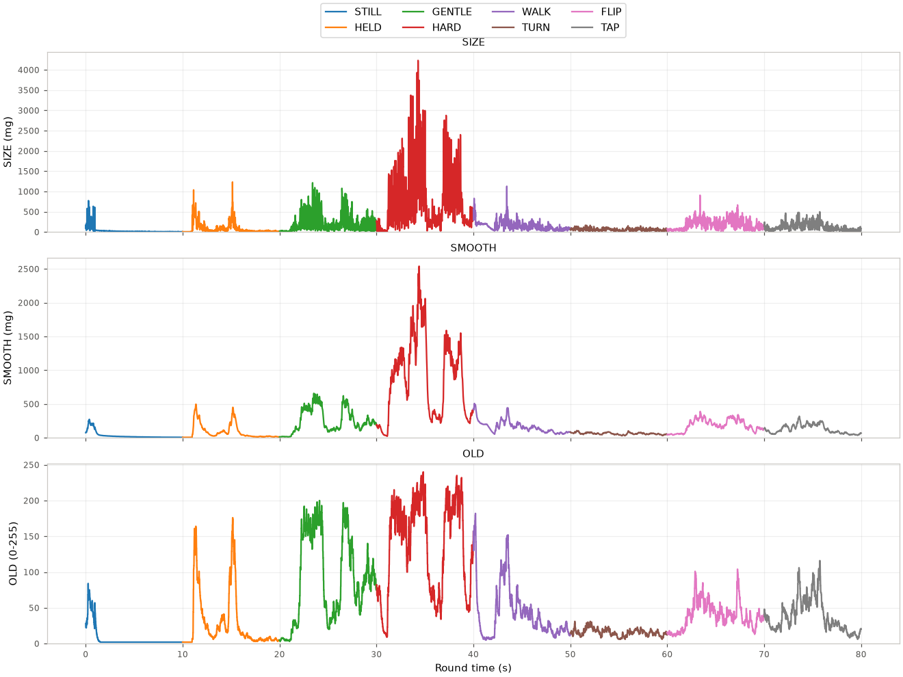
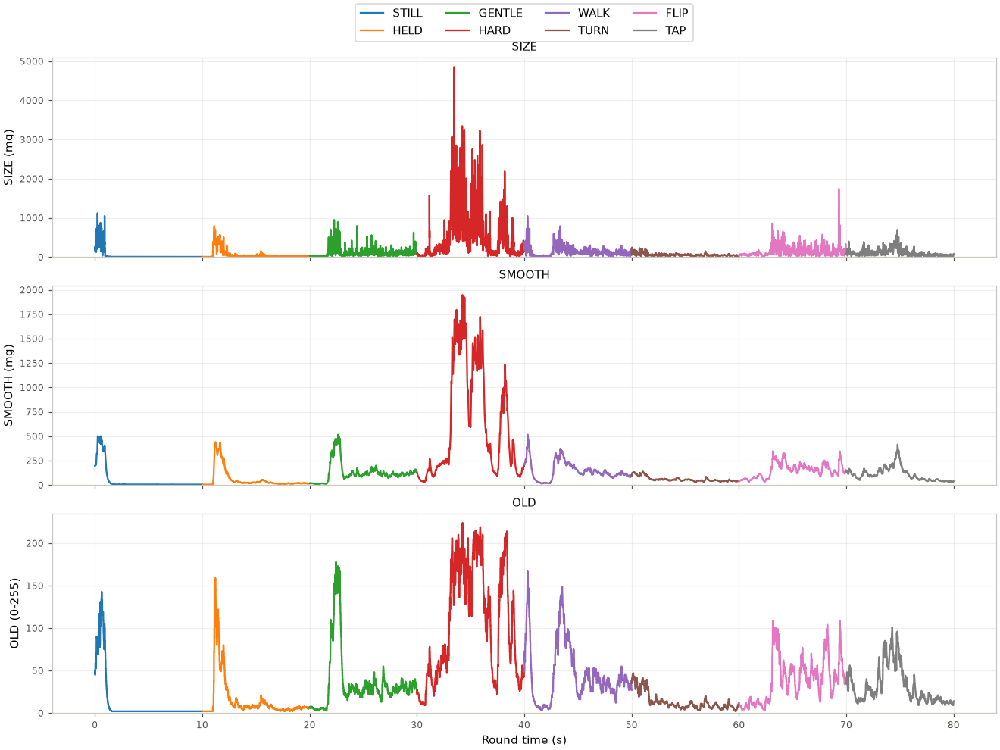

# Shake round

Input Lab's development shake page follows motion in the BOOT cycle.
It stays in default landscape with panel-axis measurements.
Tap to start; BOOT leaves the page and discards the transcript.

Linear x/y/z and SIZE show acceleration minus estimated down, in mg.
SMOOTH is the shared `shake_t` reader's smoothed linear-acceleration size.
OLD shows `tilt_shake()` on its 0–255 scale, updated once per frame.

`shake_probe.h` owns the protocol duration and bar scale.
SIZE and SMOOTH use that mg bar scale; OLD uses its full range.
Candidates continue updating outside a capture round.

## Guided capture

Disconnect USB before starting so the cable cannot constrain motion.
Each step lasts `SHAKE_PROBE_STEP_MS`. White flashes mark step changes;
a longer cyan flash marks completion. Taps during the round do not restart it.

| Step | Action |
|---|---|
| STILL | Leave it on the table |
| HELD | Hold it as in play |
| GENTLE | Shake it gently |
| HARD | Shake it hard |
| WALK | Walk while holding it |
| TURN | Turn in place |
| FLIP | Tilt and flip it quickly |
| TAP | Tap and drag the screen |

Keep the page open, reconnect USB and capture the retained transcript:

```sh
autana labdump > shake.log
python launcher/main/apps/input_lab/tools/shake_fit.py shake.log --plot shake.png
```

The transcript stays in PSRAM for repeated dumps. Reset, leaving the page or
starting another round discards it. Allocation failure displays `NO MEMORY FOR ROUND`.

## Transcript and analysis

A `round shake` header precedes `shake_step` edges and per-sample `shake` lines.
Step numbers follow `shake_probe_step_t`; timestamps are round-relative ms,
estimated from drain time and the sample period. Lost samples are not synthesized.

Each sample contains calibrated `acc` and gravity-subtracted `lin` vectors in mg,
then SIZE, SMOOTH and the current frame's OLD value.
Gravity consumes each sample separately; only the first slice carries gap/loss metadata.

The script reports median, p95, p99 and maximum for each step and candidate.
The proposed threshold is the largest p99 among STILL, HELD, WALK, TURN, FLIP and TAP;
it reports the margin to GENTLE's median and HARD's p95 as a full level.

The PNG plots candidates over time, coloured by step, with each y-axis starting
at zero. A negative margin means that candidate does not separate the protocol's
non-shake actions from gentle shaking at the proposed threshold.

## Results

SMOOTH separates a deliberate shake; a gentle shake overlaps walking.
JERKY tracks SMOOTH and is excluded from the reader and analysis.
OLD saturates: gentle shaking reads about 190, hard shaking about 220 of 255;
lifting the board reads about 165.

Regenerate both figures and tables from the retained gzip transcripts:

```sh
python launcher/main/apps/input_lab/tools/shake_fit.py --results
```

### Mixed-direction shaking



<!-- generated: shake-mixed sha256=f52bbe05bbb91d449b22ad62af064a0ba175c8c0cde8a585287d850ca8d94fc5 -->
<details>
<summary>Per-step statistics (mg; OLD 0-255)</summary>

| Step | Candidate | Median | p95 | p99 | Max |
|---|---|---|---|---|---|
| STILL | SIZE | 14.0 | 152.3 | 343.6 | 774.0 |
| STILL | SMOOTH | 14.0 | 187.3 | 247.0 | 273.0 |
| STILL | OLD | 2.0 | 46.0 | 71.0 | 84.0 |
| HELD | SIZE | 33.0 | 391.8 | 599.4 | 1233.0 |
| HELD | SMOOTH | 34.0 | 342.8 | 447.7 | 497.0 |
| HELD | OLD | 11.0 | 130.0 | 161.0 | 176.0 |
| GENTLE | SIZE | 174.0 | 757.8 | 1010.8 | 1214.0 |
| GENTLE | SMOOTH | 202.0 | 560.0 | 623.0 | 658.0 |
| GENTLE | OLD | 84.0 | 181.0 | 193.0 | 200.0 |
| HARD | SIZE | 615.0 | 2462.2 | 3333.6 | 4232.0 |
| HARD | SMOOTH | 902.5 | 1921.2 | 2322.6 | 2540.0 |
| HARD | OLD | 159.0 | 220.0 | 234.6 | 240.0 |
| WALK | SIZE | 127.0 | 369.0 | 548.8 | 1128.0 |
| WALK | SMOOTH | 146.0 | 338.1 | 484.5 | 507.0 |
| WALK | OLD | 31.0 | 120.0 | 164.0 | 182.0 |
| TURN | SIZE | 59.0 | 114.0 | 142.1 | 167.0 |
| TURN | SMOOTH | 61.0 | 88.0 | 102.0 | 107.0 |
| TURN | OLD | 15.0 | 25.0 | 29.0 | 31.0 |
| FLIP | SIZE | 169.0 | 385.8 | 500.5 | 907.0 |
| FLIP | SMOOTH | 182.0 | 316.8 | 348.8 | 390.0 |
| FLIP | OLD | 37.0 | 72.0 | 97.1 | 104.0 |
| TAP | SIZE | 98.0 | 301.5 | 423.8 | 498.0 |
| TAP | SMOOTH | 107.0 | 241.0 | 285.0 | 319.0 |
| TAP | OLD | 30.0 | 87.0 | 105.0 | 116.0 |

</details>
<!-- /generated: shake-mixed -->

### Side-to-side shaking



<!-- generated: shake-side sha256=3396fdcb911962f777f0271752e1f90508cd604ecb7e9747f71fbe3758a6bb3b -->
<details>
<summary>Per-step statistics (mg; OLD 0-255)</summary>

| Step | Candidate | Median | p95 | p99 | Max |
|---|---|---|---|---|---|
| STILL | SIZE | 6.0 | 322.0 | 691.9 | 1121.0 |
| STILL | SMOOTH | 6.0 | 379.0 | 475.4 | 502.0 |
| STILL | OLD | 2.0 | 89.0 | 124.4 | 143.0 |
| HELD | SIZE | 21.0 | 364.0 | 564.0 | 792.0 |
| HELD | SMOOTH | 21.0 | 337.0 | 425.0 | 441.0 |
| HELD | OLD | 7.0 | 73.0 | 123.0 | 159.0 |
| GENTLE | SIZE | 95.0 | 438.4 | 675.5 | 948.0 |
| GENTLE | SMOOTH | 108.0 | 419.4 | 473.9 | 517.0 |
| GENTLE | OLD | 28.0 | 141.7 | 167.0 | 178.0 |
| HARD | SIZE | 301.0 | 2083.0 | 2860.8 | 4852.0 |
| HARD | SMOOTH | 355.0 | 1601.0 | 1791.4 | 1948.0 |
| HARD | OLD | 103.0 | 206.0 | 214.0 | 224.0 |
| WALK | SIZE | 114.0 | 366.0 | 669.0 | 1047.0 |
| WALK | SMOOTH | 120.0 | 326.0 | 444.0 | 516.0 |
| WALK | OLD | 36.0 | 124.0 | 147.0 | 167.0 |
| TURN | SIZE | 51.0 | 137.9 | 191.4 | 243.0 |
| TURN | SMOOTH | 52.0 | 121.0 | 131.0 | 139.0 |
| TURN | OLD | 10.0 | 38.0 | 43.0 | 47.0 |
| FLIP | SIZE | 124.0 | 353.6 | 566.7 | 1740.0 |
| FLIP | SMOOTH | 153.0 | 283.0 | 323.0 | 350.0 |
| FLIP | OLD | 37.0 | 90.0 | 103.0 | 109.0 |
| TAP | SIZE | 80.0 | 294.3 | 463.4 | 698.0 |
| TAP | SMOOTH | 94.0 | 239.9 | 352.1 | 416.0 |
| TAP | OLD | 22.0 | 80.0 | 92.0 | 101.0 |

</details>
<!-- /generated: shake-side -->
