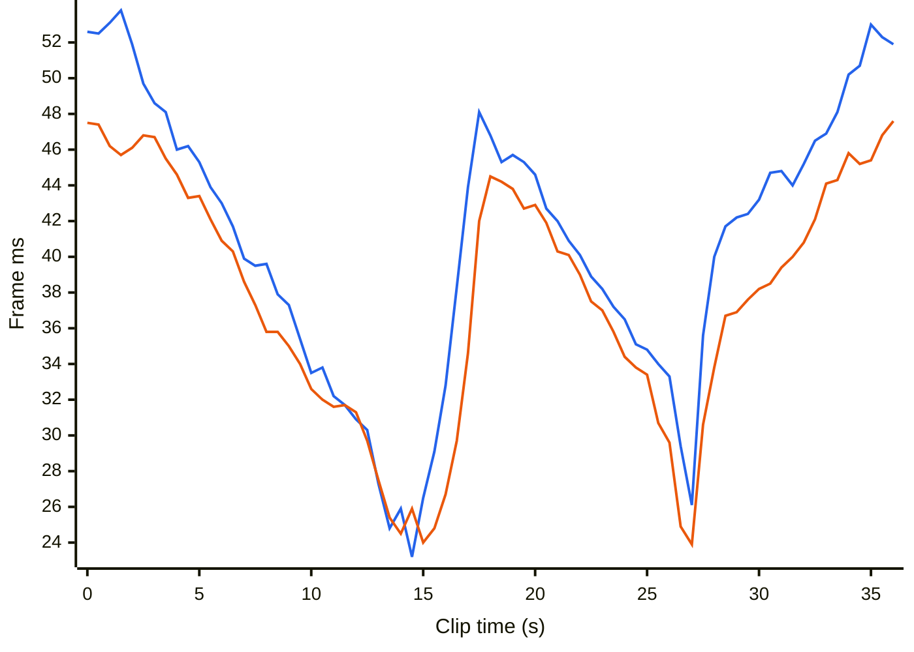

# Render Lab tools

Host-only scripts; the firmware build skips this folder. The render harness
itself is [`docs/tools/Render-Harness.md`](../../../../../docs/tools/Render-Harness.md).

Before a source bake or reference render, pull the
[mesh source files](../../../../tools/r3d/README.md).

## Host renders

```sh
./launcher/main/apps/render_lab/tools/render_lab_render_host.sh
```

Writes every declared scene under `tools/results/render/render_lab/`:
`sponza-landscape.bmp` is the atrium flythrough. These renders are
`|nopin`: their floating-point camera paths can reach different pixels
across compilers. HUD renders also format a `double` fps readout.
The fps text comes from the host fixture - time the board with a device
capture.

`render_lab_render --tune NAME=VALUE` applies a console tuning before the scene
enters; repeat it for more settings. `--live-tune NAME=VALUE` applies it after
entry, so the frame hook changes the next frame without reloading the scene.

### Menu

The BOOT menu has a SCENE dropdown of scene families (`family` in
`render_lab_scene_t`), then a VARIANT dropdown when the family has several scenes (Sponza's
bakes, from `variant`), then the rows the showing scene declares in its
`controls` (Capybara's CLIP and BLEND). Order in `scenes[]` is the order of every list, and
index 0 (Sponza Fitted Full) is the scene a start with no key shows. Console
and host scene keys are unchanged.

### Small fill

`render_lab.small_fill_ceiling`, `render_lab.small_fill_gate` and
`render_lab.small_fill_style` apply to the scene camera each frame.
On a development build the BOOT menu has a SMALL FILL dropdown with every
`SMALL_FILL_` preset; picking one sets the three tunables.


The generic scene viewer accepts `--small-fill CEILING,GATE,STYLE`; its defaults
come from `SMALL_FILL_SMOOTH`. Styles use the `small_fill_style_t` values.
The [engine feature](../../../../../docs/render/Mesh-Rendering.md#small-fill)
defines the axes and defaults.

```sh
sh launcher/tools/render/scene_viewer.sh launcher/demo/sponza/sponza.scene.toml \
    --object atrium_fitted_full --small-fill 12,16,1 -o grain.bmp
```

The app host accepts `--tune` before entry or `--live-tune` after entry.

### Menu renders

`--menu` presses BOOT on the first frame, so the render shows the scene menu
instead of the scene. `--tap X,Y` adds one press and release there, in panel
pixels: `menu-capybara-clips` opens the clip list. The menu draws over a
solid background with no float on its path, so these renders are pinned in
`render_lab_render_baseline.txt`. Re-pin with `--update-baseline` after
looking at the images.

### Camera presentation

`render_lab.present` selects the scene camera's present mode: NEAREST (0, the
default), SCANLINE (1) or DOUBLE (2), in `camera_present_t` order. Both scenes
apply it every frame, and the perf suites size and compose the same way.

```sh
autana tune render_lab.present 1
autana suite run_sponza_perf_suite --set render_lab.present=1
sh launcher/main/apps/render_lab/tools/render_lab_render_host.sh --build-only -o /tmp/present
/tmp/present/render_lab_render --scene sponza-fitted-full --tune render_lab.present=1 --no-hud -o /tmp/present/scan.bmp
```

Seeded `perf_compare` on one board, eight seeds per side, ms per frame:

| Scene | NEAREST | SCANLINE | Δ |
|---|---:|---:|---:|
| sponza fitted-full | 45.4 | 32.9 | −27.7% |
| sponza full | 43.1 | 31.2 | −27.7% |
| sponza flat | 32.7 | 25.1 | −23.3% |
| sponza lite | 34.8 | 24.3 | −30.0% |
| sponza fitted | 35.2 | 24.8 | −29.5% |
| sponza flat-fitted | 32.9 | 25.4 | −22.7% |
| capybara render (paused) | 6.75 | 3.87 | −42.7% |

A separate scoped A/B on the same day (one flash, two interleaved repeats) timed
all three modes on sponza fitted-full, in ms:

| Quarter | NEAREST | DOUBLE | SCANLINE |
|---|---:|---:|---:|
| portrait | 45.4 | 31.9 | 32.7 |
| landscape | 42.4 | 30.3 | 31.1 |

The lines follow the panel's rows and darken the clear background too. The
engine page shows the [presentation GIFs](../../../../../docs/render/Dynamic-Resolution.md#camera-presentation).

### Debug views

`--view shaded|depth|tiles|motion|meshlets` selects the declared context view.
Depth and tiles show a lit-mesh scene's depth buffer, or that depth
reduced to `RASTER_SHOW_TILE` squares. The depth is `raster_draw()`'s
own buffer, unchanged; `raster_show()` only colours it and takes each
tile's farthest depth, so the views are what the renderer holds at the
moment it upscales the frame. Near is bright and far dark, stretched over the
range that frame drew, so grey compares pixels within a frame, not across
frames; a pixel nothing reached takes the scene's clear colour, as the
shaded frame does, and a tile with one such pixel is empty.

They are ordinary renders: `sponza-depth-*.bmp` and `sponza-tiles-*.bmp`
beside `sponza-*.bmp`, each with a `.png` when Pillow is installed, turned to
the panel's orientation and the size the script declares. The picture is the
renderer's resolution, half the panel's each way, upscaled like the shaded
one. They are `|nopin` too.
`--view` sets the tunable `render_lab.view`, so on a development build
`autana tune render_lab.view N` selects view N: zero is shaded, and the remaining
values follow the render_debug_view_t table order in render/context/render_context.c. `--view` on a
scene with no lit mesh, an unknown name or no value fails the run.
`tests/test_render_views.py` checks the views against the shaded render.
Motion paints offsets red for x and green for y. Meshlets paints each mesh
cluster a flat hue, with disjoint IDs across instances.


A pose of a camera path is `--frames` times `--dt`. `--camera NAME`
selects a scene camera; omitted, it draws the first camera.
`--console FRAME:WORDS` runs the board's `render WORDS` command, such as
`clip walk 400`, before frame FRAME draws; repeat it for a sequence.

`dynres_quality.sh WORK OUT.csv CAMERA WxH [WxH ...]` scores each size
against the reference along that camera's clip, at intervals taken from
the script and over the clip's full period. Per-path results belong in
`docs/render/data/dynamic-resolution-quality-CAMERA.csv`.

The tour is authored as camera keys in `launcher/demo/sponza/tour.keys.toml`;
the pack build bakes it, so an edit there needs nothing else.

A host pose can be drawn with:

```sh
render_lab_render --scene sponza --frames 1 --dt 15000 --view depth -o depth.bmp
```

## On the board

A development build answers these from any shell, so a measurement selects
its scene by name rather than through the menu:

| Command | Does |
|---|---|
| `autana render clips` | the showing scene's clips, and which one the picker holds; a scene without a clip picker does not answer |
| `autana render clip <name> [blend_ms]` | plays that clip, blending over blend_ms, which the picker then keeps (its current blend when omitted) |
| `autana render scenes` | every scene's key and name, and which one is showing |
| `autana render scene <key>` | switches to the scene with exactly that key, such as `sponza`, `sponza-lite` or `sponza-flat-fitted` |
| `autana tune render_lab.scale <n>` | the fixed render scale in hundredths of the panel: 200 is half size |
| `autana tune render_lab.budget <ms>` | dynamic resolution on the scene showing; 0 turns it off, as does the menu's DYNAMIC RES |
| `autana tune render_lab.orbit_ms <ms>` | turns the Capybara scene's camera once about the capybara every that many milliseconds; 0 stops it |

The Capybara scene's BOOT menu holds the same clip picker: the CLIP
dropdown plays the chosen clip over the BLEND slider's time.


A screenshot's state carries an `app` object naming the scene, whether the
menu is open and the scale, so two captures can
be checked to have measured the same thing.

## Images in the docs

`doc_images.sh` here makes these in `docs/images/overview/`, run by
`launcher/tools/render/render_doc_images.sh`; see "Images in these docs" in
[`docs/tools/Render-Harness.md`](../../../../../docs/tools/Render-Harness.md).

| Image | Shows |
|---|---|
| `render-lab-sponza.gif` | the start of the Sponza flythrough, on the fitted full mesh |
| `render-lab-sponza-flat.gif` | the flythrough with the fitted flat-shaded bake |
| `render-lab-capybara.gif` | the capybara's idle, walk, walk_fast and gallop clips in turn, each blended into the next, as the camera turns once around it |

Run the app shots from the repository root with Python, Pillow, numpy and ffmpeg:

```sh
PYTHON=python sh launcher/main/apps/render_lab/tools/doc_images.sh /path/to/out /path/to/work
```

`tests/test_sky_through_walls.py`
checks the app flythrough against its sky-through-wall ceilings.

## Sponza poses

The flythrough is a glTF camera animation, `launcher/demo/sponza/flythrough.glb`,
named by `launcher/demo/sponza/flythrough.anim.toml`. Its poses for
[`report_triangle_sizes.sh`](../../../../tools/r3d/README.md#triangle-sizes)
come from [`tools/anim/track_host.py`](../../../../tools/anim/README.md),
which runs the device's track sampler over the clip, at the poses
`suite_sponza_perf.c` times (every `SPONZA_PERF_POSE_EVERY_MS`) and the size
`sponza_content.h` names and the lens of the scene's camera object
(`launcher/demo/sponza/sponza.scene.toml`):

```sh
pose_every_ms=$(python -c \
    'import sys; sys.path.insert(0, "launcher/tools"); from build.c_header import read_define; print(read_define("launcher/main/apps/render_lab/sponza_content.h", "SPONZA_PERF_POSE_EVERY_MS"))')
python launcher/tools/anim/track_host.py \
    launcher/demo/sponza/flythrough.anim.toml \
    --every "$pose_every_ms" \
    --poses camera 184 224 0.62 6 |
    ./launcher/tools/r3d/report_triangle_sizes.sh \
        --mesh sponza.atrium -
```

## The capybara asset

`launcher/demo/capybara/capybara.blend` is a hand-modelled low-poly capybara
with a control rig and in-place loops at 30 fps: `idle`, `walk`, `walk_fast`,
`gallop` and `half_bound`. It is the source asset for skinned-mesh import;
nothing in the build reads it.

Its glTF export, `capybara.glb`, is a cached bake: deform bones only,
every loop as an animation, four influences per vertex. Host tools that read
glTF use it, such as the
[skinned-mesh lighting](../../../../../docs/render/Skinned-Lighting.md)
measurement; `bake.py path capybara.glb` prints where it is.
`capybara.import.toml` names the
`.blend` and the loops to export (the file also holds the rig's own
`capyrigAction`), and `launcher/tools/bake/bake.py` runs the model-agnostic
exporter in Blender. By hand, it is:

```sh
blender --background --factory-startup --python launcher/tools/gltf/blend_skin_to_glb.py -- \
    launcher/demo/capybara/capybara.blend capybara.glb \
    --clips idle,walk,walk_fast,gallop,half_bound
```

and measure the lighting again:

```sh
launcher/tools/r3d/skin_light/report_skin_light.sh "$(python launcher/tools/bake/bake.py path capybara.glb)" gallop
```

## Meshlet size captures

Use the [meshlet capture recipe](../../../../tools/render/README.md#meshlet-size-captures)
with `--scene launcher/demo/sponza/sponza.scene.toml` and
`--suite run_sponza_perf_suite --size-tune sponza_perf.shipped_meshlet`. Its fixed flythrough samples measure the selected
renderer with both culling settings. The generated table belongs to
[Render Pipeline](../../../../../docs/render/Render-Pipeline.md#meshlets).

## Skinned frame comparison

The model-independent skin-frame tool compares scene-controlled C skinning
with the glTF reference and generates a sheet of two versus four influences.
The selected source vertices are marked red in enlarged crops. All panels use
bind colours, so the comparison isolates deformation rather than lighting.

```sh
python launcher/tools/r3d/skin/skin_frame.py "$(python launcher/tools/bake/bake.py path capybara.glb)" \
  --poses gallop:200 half_bound:200 \
  --vertices 7,11,44,54,77,129,171,205,211,260,302 \
  --out launcher/main/apps/render_lab/tools/images/skin-frame
```


The circles locate the corresponding posed vertex in each panel; a crop may
show a vertex through an occluding surface. The image difference is amplified
by the comparison tool. Exact packed-weight reference errors and per-vertex
influence-limit displacements are in
[`measurements.json`](images/skin-frame/measurements.json). This tool bakes its
own LMSH with the meshlet writer, so its vertex layout is independent
of a scene pack's bake. The sheets use the poses named on the command line.

## Perf capture quarters

The render perf suites use the shared `tests/r3d_perf_quarters.h` table.
Every timed render window runs with an explicit portrait or landscape
viewport; full-frame windows hold the display quarter. Rows include
`quarter=portrait` or `quarter=landscape`.
The skin, animate and animation-step windows have no quarter because they
do not render. The frame harness requires a held quarter and its
fixture releases the hold at exit. Raster sizes stay in physical panel
axes; the camera viewport applies the quarter turn.

`report_performance.py` reports each render quarter separately. The skin
budget is `SKIN_PERF_BUDGET_NS_PER_VERTEX` in `tests/skin_perf_log.h`.
Meshlet and reference-quality report readers select portrait for their
matching reference views.

## Frame timing profiles

`run_sponza_perf_suite` measures fixed camera poses at the spacing in
`SPONZA_PERF_POSE_EVERY_MS`. Each frame-cost row reports mean, worst,
median and p95 before presentation, with stage splits at those same poses.
The pixel-equivalence checks in that suite and the camera checks in
`suite_sponza.c` use `SPONZA_POSE_EVERY_MS`.

`run_render_lab_frame_profile_suite` plays each Sponza scene's camera clip
and the capybara gallop for one clip period in each perf quarter. It times
update, render, compose and present with the HUD hidden.

The [perf tools](../../../../tools/perf/README.md#real-time-playback)
define playback timing and the `frame_profile:` line format.

Each suite owns a table of mean goals and p95 ceilings per row and quarter.
Zero means unpegged: it logs without enforcing a budget. Board ceilings
are reported without enforcement under QEMU.

<!-- generated: frame-timing-profiles check: python launcher/main/apps/render_lab/tools/frame_profile_tables.py --pose-capture docs/render/data/sponza-perf-board.log --pose-row atrium_fitted_full --scenes sponza-fitted-full,sponza-fitted,sponza,sponza-lite,sponza-flat,sponza-flat-fitted,capybara --check -->
### Measured frame rate

Cells list board 1 / board 2.
Playback includes update, render, compose and present.

| Scene | Quarter | Mean fps | p50 ms | p95 ms | Worst ms |
|---|---|---:|---:|---:|---:|
| sponza-fitted-full | portrait | 20.9 / 20.9 | 48.4 / 48.5 | 59.8 / 59.8 | 60.6 / 60.6 |
| sponza-fitted-full | landscape | 22.1 / 22.1 | 45.8 / 45.8 | 55.3 / 55.2 | 57.4 / 57.3 |
| sponza-fitted | portrait | 25.2 / 25.2 | 40.2 / 40.2 | 47.0 / 47.0 | 47.9 / 47.9 |
| sponza-fitted | landscape | 26.4 / 26.4 | 38.3 / 38.3 | 43.9 / 43.8 | 44.4 / 44.6 |
| sponza | portrait | 20.8 / 20.8 | 48.7 / 48.8 | 58.4 / 58.3 | 59.5 / 59.5 |
| sponza | landscape | 21.5 / 21.5 | 46.7 / 46.6 | 55.3 / 55.3 | 57.1 / 57.0 |
| sponza-lite | portrait | 24.1 / 24.1 | 42.2 / 42.2 | 47.4 / 47.4 | 48.4 / 48.4 |
| sponza-lite | landscape | 24.8 / 24.8 | 40.7 / 40.8 | 45.6 / 45.6 | 46.3 / 46.3 |
| sponza-flat | portrait | 24.6 / 24.6 | 40.9 / 40.8 | 49.5 / 49.5 | 50.1 / 50.1 |
| sponza-flat | landscape | 25.0 / 25.0 | 40.3 / 40.2 | 48.0 / 48.0 | 48.8 / 48.8 |
| sponza-flat-fitted | portrait | 25.5 / 25.5 | 40.0 / 39.9 | 49.4 / 49.3 | 50.5 / 50.5 |
| sponza-flat-fitted | landscape | 26.4 / 26.4 | 38.4 / 38.5 | 47.0 / 47.0 | 48.4 / 48.3 |
| capybara | portrait | 48.1 / 48.1 | 20.8 / 20.7 | 21.0 / 21.0 | 21.7 / 21.6 |
| capybara | landscape | 46.7 / 46.7 | 21.4 / 21.4 | 21.6 / 21.5 | 21.7 / 21.6 |

### Frame cost along the flythrough

`atrium_fitted_full` on one board, before presentation, sampled every 0.5 s.
Blue is portrait; Orange is landscape.



Sources:

- `frame-profile-1-board.log`
- `frame-profile-2-board.log`
- `sponza-perf-board.log`
<!-- /generated: frame-timing-profiles -->
