# Render Lab tools

Host-only scripts; the firmware build skips this folder. The render harness
itself is [`docs/tools/Render-Harness.md`](../../../../../docs/tools/Render-Harness.md).

Before a source bake or reference render, pull the
[mesh source files](../../../../tools/r3d/README.md).

## Host renders

```sh
./launcher/main/apps/render_lab/tools/render_lab_render_host.sh
```

Writes every declared scene under `tools/results/render/render_lab/`:
`sponza-landscape.bmp` is the atrium flythrough. These renders are
`|nopin`: their floating-point camera paths can reach different pixels
across compilers. HUD renders also format a `double` fps readout.
The fps text comes from the host fixture - time the board with a device
capture. A release image draws only the scene title of the HUD: the fps
and status lines are development builds' alone.

`render_lab_render --tune NAME=VALUE` applies a console tuning before the scene
enters; repeat it for more settings. `--live-tune NAME=VALUE` applies it after
entry, so the frame hook changes the next frame without reloading the scene.

### Menu

The BOOT menu has a SCENE dropdown of scene families (`family` in
`lab_scene_t`), then a VARIANT dropdown when the family has several scenes (Sponza's
bakes, from `variant`), then the rows the showing scene declares in its
`controls` (Capybara's CLIP and BLEND). Order in `scenes[]` is the order of every list, and
index 0 (Sponza Fitted Full) is the scene a start with no key shows. Console
and host scene keys are unchanged.

### Water

The Water scene is a tank the size of the screen and as deep as the device
(`board/waveshare/esp32_s3_touch_amoled_1_8/board.toml`), filled by `flip3` and tipped by the device's gravity
and shake. The menu's WATER FILL sets the share of the tank's volume, 10 to
90 % in steps of 10.

| Command or tunable | Does |
|---|---|
| `render water fill <percent>` | sets the fill; the water refills on the next frame |
| `render water tour` | plays the scripted tour, for repeatable timings: upright, tipped right and left, laid back, flat, toward the viewer, upright, then shaken |
| `render water swing` | plays the swing the GIF below shows: rocked side to side, hard and then calmer, flipped over and straight back twice on the way, leaned back throughout |
| `water.gravity_mm_s2` | the gravity the water runs under; below Earth's, so a 35 mm tank sloshes at a pace a frame can follow |
| `water.substeps` | substeps per frame (1 to 4, default 2), each an equal share of the frame's simulated time, at most 32 ms |
| `water.two_core` | 1 (default) runs part of the particle passes, the surface field, its meshing and the shading on core 1, each cut to balance the two cores' times (`job_run_range()`); 0 keeps them on one core |
| `water.red_black` | 1 (default) solves the pressure in red-black order, each colour split across both cores; 0 in index order on one core |
| `water.samples_pct` | the surface field's density samples per cell, in hundredths (100 to 200, default 150): fewer mesh, build and draw fewer triangles and lose the smallest ripples |
| `water.show_speed_mm_s` | the speed, in mm/s, a particle outside the surface needs to show in it (default 50): slower ones rest on the surface and would each hold a one-sample spike; drops and splash fly faster; 0 shows every one |
| `water.plane` | 1 draws a plane at the fill's volume instead of flip3, its tilt following gravity's like a damped pendulum (`water.slosh_decihz`, `water.slosh_damping_pct`); much cheaper, but no crests or splash; 0 (default) is flip3 |

Each frame, while the last one goes out to the panel:

| Step | Owner |
|---|---|
| Gravity and shake, in g, box axes | `input/motion/gravity.h` |
| `water.substeps` substeps, none at rest | `physics/fluid/flip3.h` `flip3_step()` |
| The smoothed surface field | `flip3_field()` |
| Its surface, as triangles | `math/geometry/iso_surface.h` `iso_surface_nets()` |
| Shading per vertex, encoded through a table | the scene; `r3d_skin_light_encode()` |
| Clusters and a tree the raster walks | `render/dynamic/r3d_dynamic_mesh.h` |
| Drawn as the water entity | `renderer_set_mesh()` |

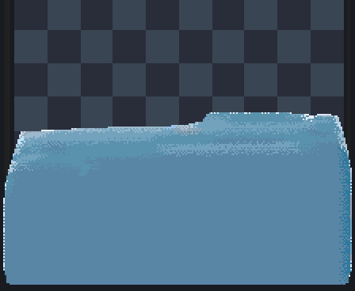

`run_water_perf_suite` plays the tour ([`tests/suite_water_perf.c`](../tests/suite_water_perf.c))
under each experiment's tunables and times every stage of the update, `flip3_step()`'s
own stages and r3d's; [`tools/water_tables.py`](water_tables.py) turns its capture into tables.
It then plays the base tour once more through the cull view, untimed, and logs one
`frame_replay` line per phase: its mean counts and its timed report, so
`stress_predict.py --scenes` scores water too (`--scene-quarter landscape`).

<!-- generated: water-stages check: python launcher/main/apps/render_lab/tools/water_tables.py --check -->
### Measured stages

The scripted tour at 33 ms of water per frame, one row per phase, from a board capture (2 runs: means are the runs' mean, p95 and worst their worst). Update is the simulation and the surface; draw is r3d drawing the water's dynamic mesh.

| Phase | Frames | Substeps/frame | Triangles | Particles | Frame mean / p95 ms | Update mean / p95 ms | Draw mean / p95 ms |
|---|---:|---:|---:|---:|---:|---:|---:|
| rest | 46 | 2.0 | 1265 | 1093 | 76.0 / 78.1 | 50.7 / 52.6 | 12.5 / 12.9 |
| tilt | 136 | 2.0 | 1352 | 1093 | 77.5 / 79.2 | 51.5 / 52.9 | 13.3 / 14.0 |
| flat | 91 | 2.0 | 1594 | 1093 | 80.7 / 86.9 | 53.1 / 55.9 | 14.8 / 18.5 |
| return | 46 | 2.0 | 1315 | 1093 | 76.4 / 78.0 | 51.1 / 52.7 | 12.5 / 13.0 |
| settle | 45 | 2.0 | 1250 | 1093 | 75.8 / 77.6 | 50.4 / 52.1 | 12.7 / 12.9 |
| shake | 60 | 2.0 | 1392 | 1093 | 77.7 / 80.0 | 51.6 / 53.2 | 13.4 / 14.2 |

Where the `base` update and draw go, ms per frame:

| Stage | rest | tilt | flat | return | settle | shake |
|---|---:|---:|---:|---:|---:|---:|
| water.step | 38.30 | 38.61 | 38.59 | 38.40 | 38.08 | 38.28 |
| water.field | 2.91 | 2.90 | 2.92 | 2.89 | 2.90 | 2.96 |
| water.through | 0.48 | 0.49 | 0.52 | 0.49 | 0.47 | 0.48 |
| water.nets | 4.62 | 4.78 | 5.40 | 4.74 | 4.58 | 4.98 |
| water.shade | 1.19 | 1.28 | 1.50 | 1.24 | 1.18 | 1.31 |
| water.build | 3.15 | 3.34 | 4.12 | 3.31 | 3.10 | 3.46 |
| step: p2g | 15.94 | 15.94 | 15.97 | 15.96 | 15.91 | 15.95 |
| step: accel | 0.38 | 0.38 | 0.38 | 0.38 | 0.38 | 0.38 |
| step: pressure | 9.95 | 10.24 | 10.20 | 10.03 | 9.77 | 9.93 |
| step: g2p | 10.83 | 10.83 | 10.84 | 10.84 | 10.83 | 10.83 |
| step: advect | 0.14 | 0.14 | 0.14 | 0.15 | 0.14 | 0.14 |
| step: collide | 0.55 | 0.55 | 0.55 | 0.54 | 0.54 | 0.55 |
| r3d.cull | 0.27 | 0.28 | 0.29 | 0.29 | 0.27 | 0.28 |
| r3d.transform | 0.49 | 0.50 | 0.61 | 0.52 | 0.48 | 0.53 |
| r3d.draw | 11.50 | 12.20 | 13.61 | 11.42 | 11.64 | 12.27 |
| r3d.upscale | 2.86 | 2.85 | 2.85 | 2.83 | 2.85 | 2.85 |

Each experiment against the base, update mean ms per frame:

| Configuration | rest | tilt | flat | return | settle | shake |
|---|---:|---:|---:|---:|---:|---:|
| base | 50.7 | 51.5 | 53.1 | 51.1 | 50.4 | 51.6 |
| one_core | 76.6 | 77.2 | 79.6 | 77.2 | 76.1 | 77.2 |
| sub4 | 88.6 | 89.7 | 91.5 | 89.0 | 88.5 | 89.7 |
| sub1 | 31.4 | 32.1 | 33.6 | 31.6 | 31.4 | 31.2 |
| index_order | 54.2 | 54.4 | 56.4 | 54.2 | 53.7 | 54.2 |
| samples2 | 59.2 | 60.4 | 63.2 | 59.9 | 58.9 | 60.7 |
| plane | 21.2 | 22.4 | 25.2 | 22.1 | 21.2 | 21.6 |

Internal RAM around each configuration, KB free / largest block:

| Configuration | before | running | after |
|---|---:|---:|---:|
| base | 56 / 48 | 55 / 46 | 56 / 48 |
| one_core | 56 / 48 | 55 / 46 | 56 / 48 |
| sub4 | 56 / 48 | 55 / 46 | 56 / 48 |
| sub1 | 56 / 48 | 55 / 46 | 56 / 48 |
| index_order | 56 / 48 | 55 / 46 | 56 / 48 |
| samples2 | 56 / 48 | 55 / 46 | 56 / 48 |
| plane | 56 / 48 | 55 / 46 | 56 / 48 |

Source: `water-stages-board.log`
<!-- /generated: water-stages -->

### Stress

The Stress family repeats a generated primitive or static pack mesh before a
swinging camera. Each preset ties down one behaviour with its own pegged goal.
The presets are the per-PR perf check for r3d work. Scenes run nightly, on
request, and for bake and fit changes; a scene regression with no preset
moving is a coverage gap and becomes a new preset.

Repeated geometry exercises hierarchical visibility<sup>[[112]](../../../../../docs/Citations.md#greene-1993)</sup>;
the presets vary the copies' geometry, layout and colour modes.

| Scene key | As the swing starts | Made of | Ties down |
|---|---|---|---|
| `stress-open` | 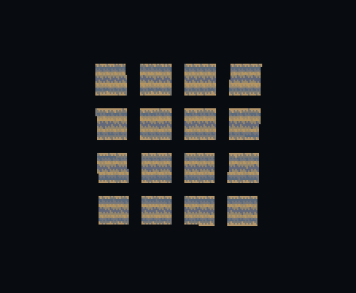 | a wall of planes side by side | hidden-cluster skip and cluster cull: nothing hides and nothing is off screen |
| `stress-stack` | 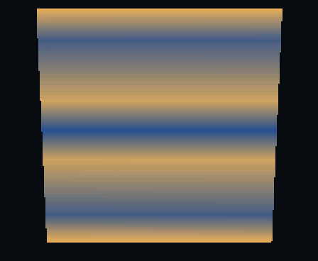 | planes one behind another | the skip's win, and the depth cost of the debug views |
| `stress-tiny-copies` | 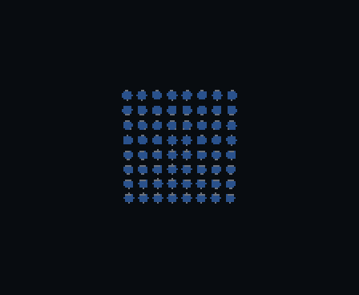 | many small spheres | dynres, present and render scale: below about 10 px smarter traversal stops paying<sup>[[113]](../../../../../docs/Citations.md#giesen-2013)</sup>, and per-copy cost rules small batches<sup>[[114]](../../../../../docs/Citations.md#wloka-2003)</sup> |
| `stress-big-tris` |  | a few triangles over most of the picture | small fill and batching |
| `stress-per-frame` | 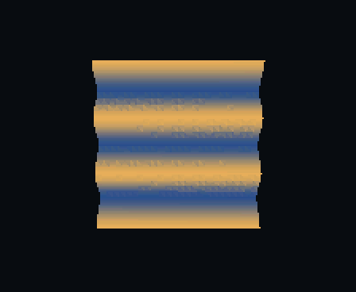 | one plane made again every frame, a wave running over it | the mesh build, every frame |
| `stress-two-sided` | 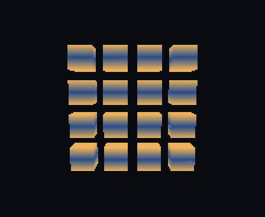 | a wall of closed cubes drawn from both sides | backface cull: half of each cube faces away and none of it is skipped |
| `stress-noisy-tiny` | 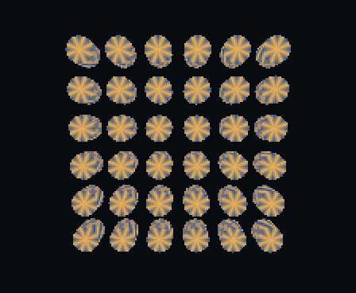 | many small cylinders end on, each end a fan of slivers whose corners are far apart in colour | the small-fill gate: every sliver is tested and none passes |
| `stress-mix` | 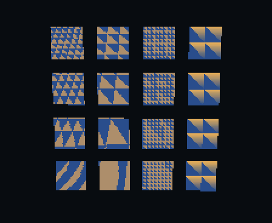 | copies cycling through tessellations; a named share of triangles has equal corner colours | a single triangle size or colour mode standing for a scene's draw cost |
| `stress-static-copies` | 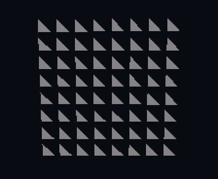 | the stress pack's LMSH triangle, retained in each renderer | static asset residency and small transform batches |
| `stress-uniform-mid` |  | equal-colour large triangles | intermediate uniform fill without shaded pixels |
| `stress-uniform-full` |  | equal-colour large triangles spanning the view | uniform fill beyond the water workload at full-width render sizes |
| `stress-card` | 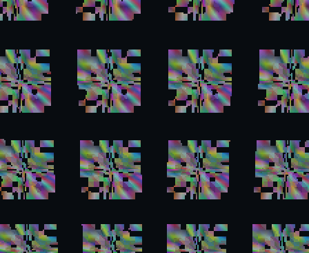 | copies sharing a generated perforated quad with uneven tessellation and procedural texture samples at its corners | scene-like small triangles with irregular edges and colour steps |
| `stress-culled` | 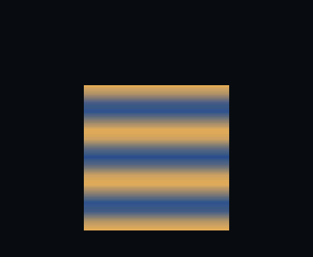 | a tessellated plane and a camera pitching beyond its edge | varying cluster rejection by the frustum |
| `stress-near` | 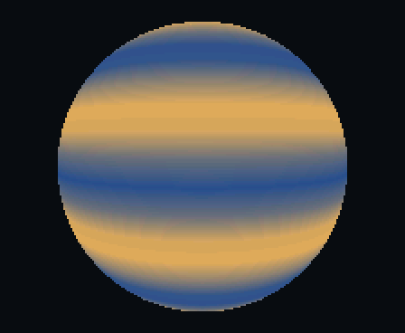 | stacked spheres and a camera passing through their front surfaces | triangles behind and crossing the near plane |
| `stress-few-copies` | 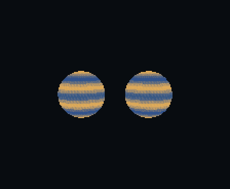 | two dense spheres side by side | the two-core cull split: with one instance a core, its fork and join cost more than the halved walk saves |
| `stress-carved-near` | 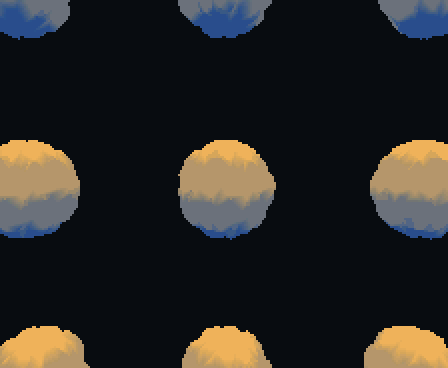 | a few copies of a banded bumpy ball, baked with levels of detail, close to the camera | the carve's finest levels: each copy draws near its full shape |
| `stress-carved-far` | 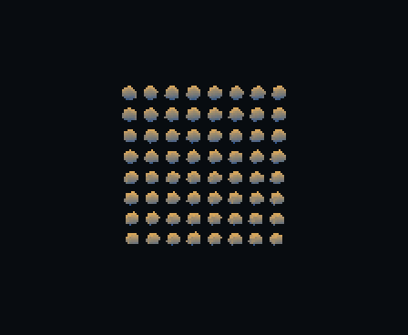 | many copies of the same ball, small in the distance | per-copy level picks: far copies draw their coarse levels |
| `stress-textured` | 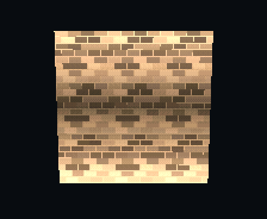 | the big-tris layout, its banded light multiplied by a generated 4-bit brick texture ([LTEX](../../../../../docs/assets/formats/LTEX.md)) | the textured span fill against the same pixels drawn plain in `stress-big-tris` |
| `stress-foliage-near` | 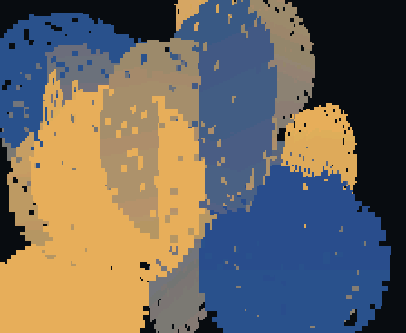 | three bushes one behind another over the whole view, each 24 small cards turned and overlapping several deep, cut by a generated MASK1 texture ([LTEX](../../../../../docs/assets/formats/LTEX.md)) keeping about 0.7 | the masked textured fill at its largest: foliage cards' overdraw near the camera |
| `stress-foliage-near-opaque` | 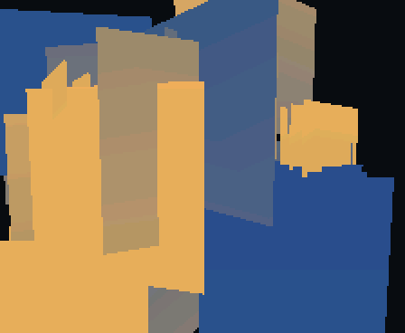 | `stress-foliage-near`'s cards under the INDEX4 brick, whole | the twin: against it, the near cards' mask costs alone |
| `stress-foliage-far` | 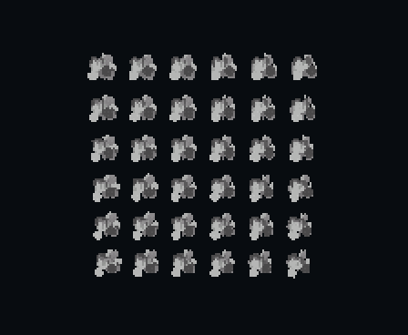 | 36 small bushes side by side, their cards a few pixels across | the masked textured fill on small triangles, as distant foliage draws |
| `stress-foliage-far-opaque` | 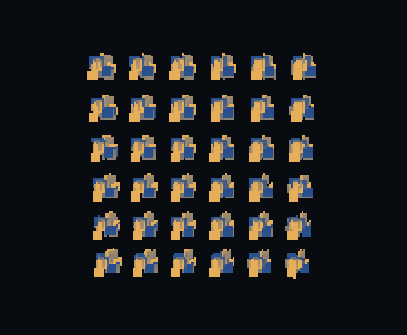 | `stress-foliage-far`'s cards under the INDEX4 brick, whole | the twin: against it, the far cards' mask costs alone |

A change is judged by each preset's own readout, stage by stage. The sum over
presets is a summary line only. A draw change can win on two-sided and static
copies and lose on card, noisy-tiny and per-frame: the sum says win, and a
scene of small triangles follows the losing presets.

A small preset still counts. Its behaviour may weigh little in a scene, and a
win on it is still worth taking.

The presets move with the scenes. Each change below was switched off in one
build and timed against the build with it, presets and scenes alike:

| Change | Switched off by | Presets against scenes |
|---|---|---|
| [Uniform solid fill](https://github.com/jose-villegas/autana/pull/1406) | its test made false | draw: the sum agrees on 4 of 5 scenes; Sponza follows its small-triangle presets |
| [Two-core cull](https://github.com/jose-villegas/autana/pull/1475) | the cull on one core | cull: Sponza and Bistro agree; capybara's one instance a core is the `few-copies` case |

A comment-only control moved nothing beyond same-build noise. The rule: only
an opposite sign beyond noise fails; a scene that moves with no preset moving
is a coverage gap, closed by a new preset.

The card's holes, uneven cells and fixed procedural texture are generated in
`stress_preset.c`. Its mesh is built once and shared by the copies. Procedural
geometry keeps the stress bake independent of imported scene sources.

The host renderer's path means compare its triangle-size mix with the scene
means in [`scene-triangle-bins.json`](../../../../../docs/render/data/scene-triangle-bins.json).
Regenerate the card means with:

```sh
python launcher/main/apps/render_lab/tools/scene_triangle_bins.py --scene stress-card 600 --out docs/render/data/stress-triangle-bins.json
```

Card path means are in [`stress-triangle-bins.json`](../../../../../docs/render/data/stress-triangle-bins.json).

The culled camera samples each quarter's frustum edge; the near camera
traverses the stacked surfaces. Their sweeps are claims of
[`tests/suite_stress_preset.c`](../tests/suite_stress_preset.c).

| Part | Owner |
|---|---|
| Presets: each ID, key and surface | `stress/stress_preset.h` `STRESS_PRESETS` |
| Each preset's shape, copies and layout | `stress/stress_preset.c` `stress_presets` |
| Primitive shapes | `math/geometry/primitive_mesh.h` |
| Shared dynamic meshes for the copies | `render/dynamic/r3d_dynamic_mesh.h` |
| The camera tracks, a still camera, and a pool of copies | `launcher/demo/stress/` |
| Each preset's sizes, by the renderer's own limits | [`tests/suite_stress_preset.c`](../tests/suite_stress_preset.c) |
| Each preset's corner in a render, by the cull counts | [`tools/tests/test_stress_corners.py`](tests/test_stress_corners.py) |
| Scene mean triangle bins | [`tools/scene_triangle_bins.py`](scene_triangle_bins.py), [`scene-triangle-bins.json`](../../../../../docs/render/data/scene-triangle-bins.json) |
| Each preset's stage times and goals on the board | [`tests/suite_stress_perf.c`](../tests/suite_stress_perf.c) |
| Stage cost model and held-out scoring | [`tools/stress_predict.py`](stress_predict.py) |

The `run_stress_perf_suite` suite replays both `lab_perf_quarters` along each
preset's swing. `stress_presets[].perf_poses` owns sampling density.
Uniform presets also replay the full and half-height render_lab ladder steps.

Every row uses `LAB_LAYOUT_FULL`, composing from the half picture when it fits.
Double-buffer presentation runs asynchronously on core 1 and can delay the
transform worker's fork/join.

`transform_batches` counts the shaded draw's transform fork/joins, empty ones
included, read from the census by `raster_batch_count()`. Each pays the split,
worker dispatch, cluster work and join; picture clearing belongs to `r3d.draw`.

Each suite row (preset, quarter, size) has a goal per r3d stage, which reports
its distance only, and a goal and board ceiling on the stages' sum, all on the
mean over the row's poses. The suite's goal table says which preset stays unpegged.

[`stress_goals.py`](stress_goals.py) prints that table from the suite's
`PERF TARGET` lines: per row, the worst capture of five layout seeds on every
perf board, plus the script's margins. Regenerate it with:

```sh
python launcher/main/apps/render_lab/tools/stress_goals.py --unpegged stress-uniform-full CAPTURE...
```

Each pose draws one counted frame, one warm frame and `FRAME_PROFILE_REPLAY_DRAWS`
measured frames. The pose counts and size loops in the suite own its frame
budget.

Static copies retain the pack's mesh and its scene-owned PSRAM arrays.
Dynamic copies also use PSRAM and the same packed-int16 transform loop;
`vertices_transformed` therefore serves both without a storage-kind split.

`stress_predict.py` is a diagnostic: it fits stage costs to the counts and
reads stage deltas between two arms. The goals are the bar, never the fit.
Its per-stage inputs are owned by `STAGE_INPUTS` in [stress_predict.py](stress_predict.py).

The fit under-predicts draw, misses cull's per-call cost and never trains the
doubled, mapped or blocks upscale paths, so its frame estimate is no scene time.

| Flags | Input or selection |
|---|---|
| `--a`, `--scenes` | stress training capture and held-out scene capture |
| `--b`, `--scenes-a`, `--scenes-b` | second stress arm and paired scene arms for stage deltas |
| `--noise-a`, `--noise-b` | same-build pair for the measured noise floor |
| `--layout-a`, `--layout-b` | matching poses with different layout seeds |
| `--scene KEY ...` | selected scene rows |
| `--quarter`, `--scene-quarter` | training and held-out quarters |

Pairs require shared pose keys for every scene. Captures must contain every
model count and stage; unsupported inputs and failed scoring rows fail the run.

Replay counts describe the timed shaded compose. `render_width/height` and
`output_width/height` give its sizes; `upscale_path` is `upscale_path_t`, and
`upscale_surface` records surface filtering. The scorer derives pixel areas.

```sh
python launcher/main/apps/render_lab/tools/stress_predict.py --a stress-a.log \
    --scenes scenes-a.log
python launcher/main/apps/render_lab/tools/stress_predict.py \
    --a stress-a.log --b stress-b.log \
    --scenes-a scenes-a.log --scenes-b scenes-b.log \
    --noise-a repeat-a.log --noise-b repeat-b.log \
    --layout-a layout-a.log --layout-b layout-b.log
```

`render_lab_render --view cull --counts FILE` writes every
`RASTER_CULL_FRAME_FIELDS` count per frame. The `sized_*` fields use
`R3D_SIZES_FIELDS`: face, uniform and shaded modes, each split by covered
pixel centres. Their sum is `triangles_set_up`; clipped triangles stay separate.

`--camera still` holds the camera, so a frame differs from the last only
where the mesh moved. Mixed copies share meshes by tessellation;
`STRESS_MIX_UNIFORM_PERIOD` owns their equal-colour share.

### Herd

The Herd family is N skinned capybaras walking the capybara's meadow. Each
takes legs to seeded points in a 6 m circle, at the speed of one of its clips
or grazing in place, keeps apart from the others and plays the clip and rate
its ground speed calls for. One finger orbits the camera round that circle, as
in the Capybara scene; zoomed in, copies fall off the frame and behind the
camera, so the per-copy costs of posing, skinning and culling all show.

| Step, every 20 ms | Owner |
|---|---|
| Each copy's leg: a target and speed, or a graze | `herd/herd_wander.h` |
| Keep apart, look ahead, stay inside; then arrive with what acceleration is left | `math/motion/steer2f.h` ([Motion](../../../../../docs/math/Motion.md)) |
| The clip and rate for the copy's speed | `locomotion/gait.h`, from each clip's `ground_mm_s` ([TRCK](../../../../../docs/assets/formats/TRCK.md)) |

`pose <ms>` seeks the whole herd: it walks again from its seed to that time,
so two seeks to one time draw the same frame. Played on from there, clip phases
can differ slightly from an unbroken run, which steps clips by frame time.

| Scene key | Copies shown |
|---|---|
| `herd-1` | the centre one |
| `herd-4` | centre, near, far out and to the side |
| `herd-8` | the whole pool |

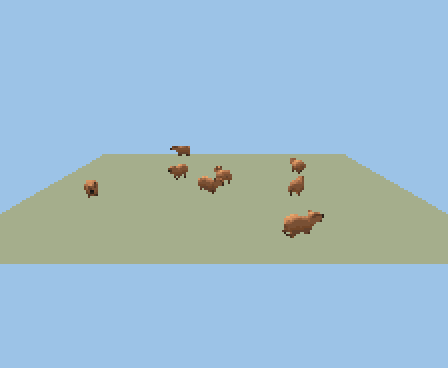

| Part | Owner |
|---|---|
| Sizes: each ID, key and copy count | `herd/scene_herd.h` `HERD_SIZES` |
| The pool, and each copy's start | `launcher/demo/capybara/herd.scene.toml` |
| The walk: area, legs, steering limits and gait rates | `herd/scene_herd.c` |
| The camera, orbited round the area | [`lab/lab_orbit.h`](../../../lab/lab_orbit.h) |
| Each size's copies, and a turn's frame and animation-step cost with their stages (`herd.wander`, `herd.gait`, the animation step's and r3d's); a paced row steps each frame by the last one's time | [`tests/suite_herd_perf.c`](../tests/suite_herd_perf.c) |
| The suite's timing table for `perf_compare.sh` | [`herd_tables.py`](herd_tables.py) `--perf-table CAPTURE TABLE` |

### Small fill

`render_lab.small_fill_ceiling`, `render_lab.small_fill_gate` and
`render_lab.small_fill_style` apply to the scene camera each frame.
The BOOT menu has a SMALL FILL dropdown with every `SMALL_FILL_` preset;
picking one sets the three tunables. Every menu option is in a release
image too.
The host renderer picks one by its menu label, as
`--small-fill "FAST - DITHER"`.

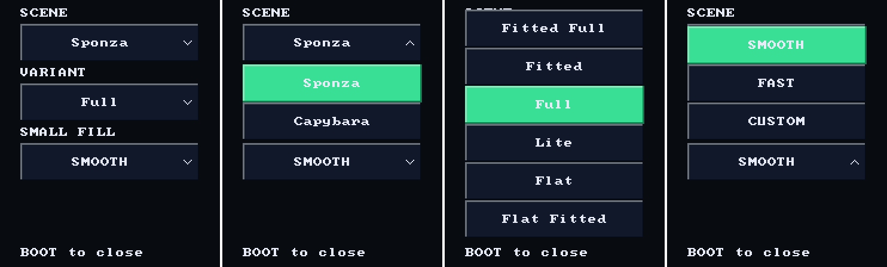

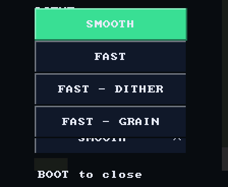

Below it, UPSCALE picks how a draw half the panel's width or less fills the panel:
SHARP repeats pixels (the default), SMOOTH blends within a surface and keeps
depth edges sharp
([Dynamic-Resolution.md](../../../../../docs/render/frame/Dynamic-Resolution.md#upscaling-within-a-surface)).
It sets `render_lab.upscale`.

The generic scene viewer accepts `--small-fill CEILING,GATE,STYLE`; its defaults
come from `SMALL_FILL_SMOOTH`. Styles use the `small_fill_style_t` values.
The [engine feature](../../../../../docs/render/frame/Coverage.md#small-fill)
defines the axes and defaults.

```sh
sh launcher/tools/render/scene_viewer.sh launcher/demo/sponza/sponza.scene.toml \
    --object atrium_fitted_full --small-fill 12,16,1 -o grain.bmp
```

The app host accepts `--tune` before entry or `--live-tune` after entry.

### Menu renders

`--menu` presses BOOT on the first frame, so the render shows the scene menu
instead of the scene. `--tap X,Y` adds one press and release there, in panel
pixels: `menu-capybara-clips` opens the clip list. The menu draws over a
solid background with no float on its path, so these renders are pinned in
`render_lab_render_baseline.txt`. Re-pin with `--update-baseline` after
looking at the images.

### Camera presentation

`render_lab.present` selects the scene camera's present mode: NEAREST (0, the
default), SCANLINE (1) or DOUBLE (2), in `camera_present_t` order. Both scenes
apply it every frame, and the perf suites size and compose the same way.

```sh
autana tune render_lab.present 1
autana suite run_sponza_perf_suite --set render_lab.present=1
sh launcher/main/apps/render_lab/tools/render_lab_render_host.sh --build-only -o /tmp/present
/tmp/present/render_lab_render --scene sponza-fitted-full --tune render_lab.present=1 --no-hud -o /tmp/present/scan.bmp
```

Seeded `perf_compare` on one board, eight seeds per side, ms per frame:

| Scene | NEAREST | SCANLINE | Δ |
|---|---:|---:|---:|
| sponza fitted-full | 45.4 | 32.9 | −27.7% |
| sponza full | 43.1 | 31.2 | −27.7% |
| sponza flat | 32.7 | 25.1 | −23.3% |
| sponza lite | 34.8 | 24.3 | −30.0% |
| sponza fitted | 35.2 | 24.8 | −29.5% |
| sponza flat-fitted | 32.9 | 25.4 | −22.7% |
| capybara render (paused) | 6.75 | 3.87 | −42.7% |

A separate scoped A/B on the same day (one flash, two interleaved repeats) timed
all three modes on sponza fitted-full, in ms:

| Quarter | NEAREST | DOUBLE | SCANLINE |
|---|---:|---:|---:|
| portrait | 45.4 | 31.9 | 32.7 |
| landscape | 42.4 | 30.3 | 31.1 |

The lines follow the panel's rows and darken the clear background too. The
engine page shows the [presentation GIFs](../../../../../docs/render/frame/Dynamic-Resolution.md#camera-presentation).

### Debug views

`--view shaded|depth|tiles|meshlets|cull|overdraw` selects the declared context view.
Depth and tiles show a lit-mesh scene's depth buffer, or that depth
reduced to `RASTER_SHOW_TILE` squares. The depth is `raster_draw()`'s
own buffer, unchanged; `raster_show()` only colours it and takes each
tile's farthest depth, so the views are what the renderer holds at the
moment it upscales the frame. Near is bright and far dark, stretched over the
range that frame drew, so grey compares pixels within a frame, not across
frames; a pixel nothing reached takes the scene's clear colour, as the
shaded frame does, and a tile with one such pixel is empty.

Overdraw colours each pixel by how many triangle spans tested it, blue for
one to red for `RASTER_OVERDRAW_RAMP_LAYERS` or more, on the same scale every
frame. The last frame's totals go to stderr as one `overdraw:` line
(`RASTER_OVERDRAW_LINE`): pixels tested, layers tested and written summed
over them, and the most at one pixel.

They are ordinary renders: `sponza-depth-*.bmp` and `sponza-tiles-*.bmp`
beside `sponza-*.bmp`, each with a `.png` when Pillow is installed, turned to
the panel's orientation and the size the script declares. The picture is the
renderer's resolution, half the panel's each way, upscaled like the shaded
one. They are `|nopin` too.
`--view` sets the tunable `render_lab.view`, so on a development build
`autana tune render_lab.view N` selects view N: zero is shaded, and the remaining
values follow the render_debug_view_t table order in render/context/render_context.c. `--view` on a
scene with no lit mesh, an unknown name or no value fails the run.
`tests/test_render_views.py` checks the views against the shaded render.
Motion paints offsets red for x and green for y. Meshlets paints each mesh
cluster a flat hue, with disjoint IDs across instances.

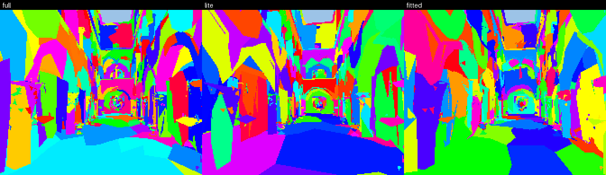

A pose of a camera path is `--frames` times `--dt`. `--camera NAME`
selects a scene camera; omitted, it draws the first camera.
`--console FRAME:WORDS` runs the board's `render WORDS` command, such as
`clip walk 400`, before frame FRAME draws; repeat it for a sequence.
`--dump DIR` writes each frame's raster colour and depth, before the
upscale, to `DIR/NNNN.raw` for the frame generation experiment
([Frame-Generation.md](../../../../../docs/render/frame/Frame-Generation.md)).

`dynres_quality.sh [--scene-file F --scene KEY] [--args "ARGS"] WORK OUT.csv CAMERA WxH [WxH ...]`
scores each size against the reference along that camera's clip, at
intervals taken from the script and over the clip's full period. Per-path
results belong in `docs/render/data/dynamic-resolution-quality-CAMERA.csv`.
`upscale_quality.sh` runs it per scene under each upscale filter, for
[Dynamic-Resolution.md](../../../../../docs/render/frame/Dynamic-Resolution.md#upscaling-within-a-surface):

```sh
sh launcher/main/apps/render_lab/tools/upscale_quality.sh /tmp/upscale docs/render/data/upscale-filter-quality.csv     docs/render/data/upscale-frames camera launcher/demo/bistro/bistro.scene.toml:bistro-fitted-full     launcher/demo/sponza/sponza.scene.toml:sponza-fitted-full launcher/demo/sponza/sponza.scene.toml:sponza-fitted     launcher/demo/sponza/sponza.scene.toml:sponza-flat-fitted launcher/demo/sponza/sponza.scene.toml:sponza     launcher/demo/sponza/sponza.scene.toml:sponza-flat launcher/demo/sponza/sponza.scene.toml:sponza-lite
```

The tour is authored as camera keys in `launcher/demo/sponza/tour.keys.toml`;
the pack build bakes it, so an edit there needs nothing else.

A host pose can be drawn with:

```sh
render_lab_render --scene sponza --frames 1 --dt 15000 --view depth -o depth.bmp
```

## On the board

A development build answers these from any shell, so a measurement selects
its scene by name rather than through the menu:

| Command | Does |
|---|---|
| `autana render clips` | the showing scene's clips, and which one the picker holds; a scene without a clip picker does not answer |
| `autana render clip <name> [blend_ms]` | plays that clip, blending over blend_ms, which the picker then keeps (its current blend when omitted) |
| `autana render view <name>` | holds the Capybara scene's camera still on a named view: `home`, `front`, `side`, `back`, or `close` (home's angle at the zoom-in limit) |
| `autana render scenes` | every scene's key and name, and which one is showing |
| `autana render scene <key>` | switches to the scene with exactly that key, such as `sponza`, `sponza-lite` or `sponza-flat-fitted` |
| `sh launcher/main/apps/render_lab/tools/floor_shots.sh [--flash] --out <dir>/shots.txt <scene>@<ms>...` | screenshots each pose at the chosen size and at the dynamic-resolution floor, into `<dir>` |
| `autana render pose <ms>` | holds the scene's path at that time: a baked scene's camera, or the capybara's gallop; `autana render pose play` lets it move again |
| `autana tune render_lab.scale <n>` | the fixed render scale in hundredths of the panel: 200 is half size |
| `autana tune render_lab.budget <ms>` | dynamic resolution on the scene showing; 0 turns it off, as does the menu's DYNAMIC RES |
| `autana tune render_lab.framegen 1` | every other frame is generated from the one before instead of drawn; 0 draws them all, as does the menu's FRAME GEN |
| `autana tune render_lab.orbit_ms <ms>` | turns the Capybara scene's camera once about the capybara every that many milliseconds; 0 stops it |

### Flying the camera

`fly.py` flies the showing scene's camera from this machine's keyboard and
mouse while the board draws it, to look at a scene, a fit or an LOD from
anywhere:

```sh
python launcher/main/apps/render_lab/tools/fly.py --scene sponza-fitted-full
```

| Input | Does |
|---|---|
| W, S | forward, back |
| A, D | left, right |
| E, Q | up, down along the world's up |
| right-drag | look: yaw and pitch, the horizon level |
| wheel | scales the speed |
| P | prints where the camera is |

It needs a development image on the board with Render Lab open. The window
sends `render fly <right> <up> <forward> <drag x> <drag y> <wheel>` lines
through `device.py stream`, which holds the board's lock while it is open,
and the board flies the camera every frame from the keys held
([render_lab_fly.h](../console/render_lab_fly.h), [fly reference](../../../../../docs/kinematics/Fly.md)):

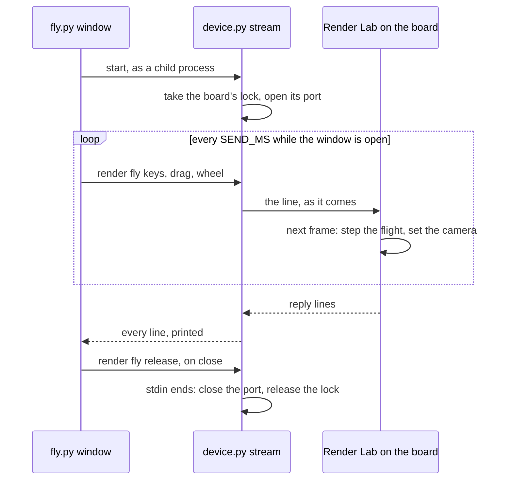

A flight starts at the speed that crosses the scene corner to corner in
`RENDER_LAB_FLY_CROSSING_S` seconds, whatever its units. The camera's clip
pauses while it flies. Closing the window, `render fly release`, a scene
switch or `RENDER_LAB_FLY_IDLE_MS` with no line puts the camera back, its
clip paused or playing as it was before.

The Capybara scene's BOOT menu holds the same clip picker: the CLIP
dropdown plays the chosen clip over the BLEND slider's time.


A screenshot's state carries an `app` object naming the scene, whether the
menu is open and the scale, so two captures can
be checked to have measured the same thing.

## Images in the docs

`doc_images.sh` here makes these in `docs/images/overview/`, run by
`launcher/tools/render/render_doc_images.sh`; see "Images in these docs" in
[`docs/tools/Render-Harness.md`](../../../../../docs/tools/Render-Harness.md).

| Image | Shows |
|---|---|
| `render-lab-sponza.gif` | the start of the Sponza flythrough, on the fitted full mesh |
| `render-lab-capybara.gif` | every clip the capybara scene lists, in its order and for an equal time, each blended into the next and, more slowly, back to the first, as the camera turns once around it |
| `render-lab-water.gif` | the water scene's swing (`render water swing`): rocked side to side, hard and then calmer, flipped over and straight back twice on the way, leaned back so the surface shows, in the `FAST - DITHER` small fill; landscape, as the other clips |

Run the app shots from the repository root with Python, Pillow and numpy:

```sh
PYTHON=python sh launcher/main/apps/render_lab/tools/doc_images.sh /path/to/out /path/to/work
```

`tests/test_sky_through_walls.py`
checks the app flythrough against its sky-through-wall ceilings.

## Sponza poses

The flythrough is a glTF camera animation, `launcher/demo/sponza/flythrough.glb`,
named by `launcher/demo/sponza/flythrough.anim.toml`. Its poses for
[`report_triangle_sizes.sh`](../../../../tools/r3d/README.md#triangle-sizes)
come from [`tools/anim/track_host.py`](../../../../tools/anim/README.md),
which runs the device's track sampler over the clip, at the poses
`suite_sponza_perf.c` times (every `SPONZA_PERF_POSE_EVERY_MS`) and the size
`sponza_content.h` names and the lens of the scene's camera object
(`launcher/demo/sponza/sponza.scene.toml`):

```sh
pose_every_ms=$(python -c \
    'import sys; sys.path.insert(0, "launcher/tools"); from build.c_header import read_define; print(read_define("launcher/main/apps/render_lab/sponza_content.h", "SPONZA_PERF_POSE_EVERY_MS"))')
python launcher/tools/anim/track_host.py \
    launcher/demo/sponza/flythrough.anim.toml \
    --every "$pose_every_ms" \
    --poses camera 184 224 0.62 6 |
    ./launcher/tools/r3d/report_triangle_sizes.sh \
        --mesh sponza.atrium -
```

## The capybara asset

`launcher/demo/capybara/capybara.blend` is a hand-modelled low-poly capybara
with a control rig and in-place loops at 30 fps: `idle`, `walk`, `walk_fast`,
`gallop` and `half_bound`. It is the source asset for skinned-mesh import;
nothing in the build reads it.

Its glTF export, `capybara.glb`, is a cached bake: deform bones only,
every loop as an animation, four influences per vertex. Host tools that read
glTF use it, such as the
[skinned-mesh lighting](../../../../../docs/render/animation/Skinned-Lighting.md)
measurement; `bake.py path capybara.glb` prints where it is.
`capybara.import.toml` names the
`.blend` and the loops to export (the file also holds the rig's own
`capyrigAction`), and `launcher/tools/bake/bake.py` runs the model-agnostic
exporter in Blender. By hand, it is:

```sh
blender --background --factory-startup --python launcher/tools/gltf/blend_skin_to_glb.py -- \
    launcher/demo/capybara/capybara.blend capybara.glb \
    --clips idle,walk,walk_fast,gallop,half_bound
```

and measure the lighting again:

```sh
launcher/tools/r3d/skin_light/report_skin_light.sh "$(python launcher/tools/bake/bake.py path capybara.glb)" gallop
```

## Meshlet size captures

Use the [meshlet capture recipe](../../../../tools/render/README.md#meshlet-size-captures)
with `--scene launcher/demo/sponza/sponza.scene.toml` and
`--suite run_sponza_perf_suite --size-tune sponza_perf.shipped_meshlet`. Its fixed flythrough samples measure the selected
renderer with both culling settings. The generated table belongs to
[Baked-Mesh](../../../../../docs/render/offline/Baked-Mesh.md#meshlets).

## Skinned frame comparison

The model-independent skin-frame tool compares scene-controlled C skinning
with the glTF reference and generates a sheet of two versus four influences.
The selected source vertices are marked red in enlarged crops. All panels use
bind colours, so the comparison isolates deformation rather than lighting.

```sh
python launcher/tools/r3d/skin/skin_frame.py "$(python launcher/tools/bake/bake.py path capybara.glb)" \
  --poses gallop:200 half_bound:200 \
  --vertices 7,11,44,54,77,129,171,205,211,260,302 \
  --out launcher/main/apps/render_lab/tools/images/skin-frame
```

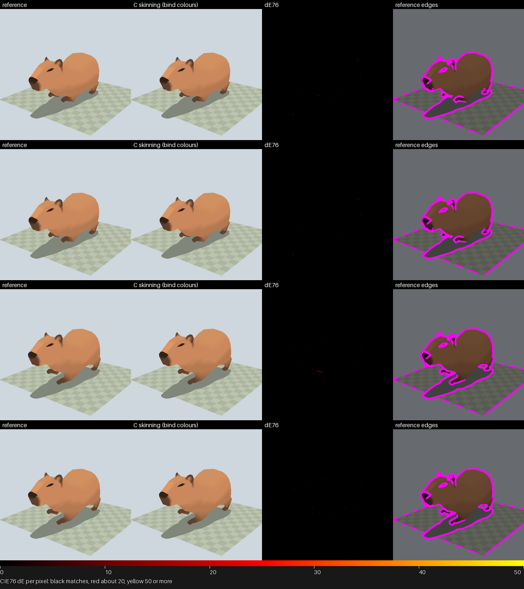

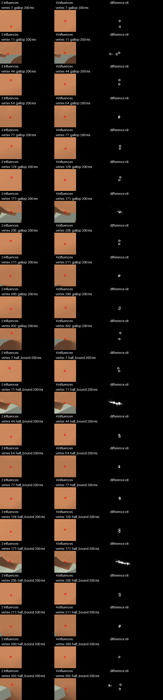

The circles locate the corresponding posed vertex in each panel; a crop may
show a vertex through an occluding surface. The image difference is amplified
by the comparison tool. Exact packed-weight reference errors and per-vertex
influence-limit displacements are in
[`measurements.json`](images/skin-frame/measurements.json). This tool bakes its
own LMSH with the meshlet writer, so its vertex layout is independent
of a scene pack's bake. The sheets use the poses named on the command line.

## Perf capture quarters

The render perf suites use the shared lab table `lab/test/lab_perf_quarters.h`.
Every timed render window runs with an explicit portrait or landscape
viewport; full-frame windows hold the display quarter. Rows include
`quarter=portrait` or `quarter=landscape`.
The skin, animate and animation-step windows have no quarter because they
do not render. The frame harness requires a held quarter and its
fixture releases the hold at exit. Raster sizes stay in physical panel
axes; the camera viewport applies the quarter turn.

`report_performance.py` reports each render quarter separately. The skin
budget is `SKIN_PERF_BUDGET_NS_PER_VERTEX` in `tests/skin_perf_log.h`.
Meshlet and reference-quality report readers select portrait for their
matching reference views.

## Frame timing profiles

`run_sponza_perf_suite` measures fixed camera poses at the spacing in
`SPONZA_PERF_POSE_EVERY_MS`: the showcase bake with culling on and off, and
the full bake placed by a moving model. Each frame-cost row reports mean,
worst, median and p95 before presentation, with stage splits at those same poses.
The pixel-equivalence checks in that suite and the camera checks in
`suite_sponza.c` use `SPONZA_POSE_EVERY_MS`.

`run_render_lab_frame_profile_suite` plays each fitted Sponza scene's camera clip,
Bistro fitted-full's camera clip and the capybara gallop for one clip period in each perf quarter. It times
update, render, compose and present with the HUD hidden.

After each playback the suite finds its frame peaks: the path is a loop, so
a peak across its end is one. A peak counts when it stands
`FRAME_PROFILE_PEAK_PERCENT` of its height above the higher of
its two saddles, and its slowest frame stands for it. The suite then replays
poses paused: `FRAME_PROFILE_PATH_POSES` spread evenly along the path, then
every frame peak's, highest first.
Each replay draws one frame through the `cull` view for its counts and
`FRAME_PROFILE_REPLAY_DRAWS` shaded frames for their frame-cost report.
A paused frame does not skin again, so capybara's replayed split has no
skinning in it. `report_performance.py` ranks the frame peaks with those
splits and counts. Its "why" names the stage that most exceeds the path's
median pose and the count furthest above its median.

The [perf tools](../../../../tools/perf/README.md#real-time-playback)
define playback timing and the `frame_profile:` line format.

Each suite owns a table of mean goals and p95 ceilings per row and quarter.
Zero means unpegged: it logs without enforcing a budget. Board ceilings
are reported without enforcement under QEMU.

<!-- generated: frame-timing-profiles check: python launcher/main/apps/render_lab/tools/frame_profile_tables.py --peak-board 1 --check -->
### Measured frame rate

Cells list board 1.
Playback includes update, render, compose and present.

| Scene | Quarter | Mean fps | p50 ms | p95 ms | Worst ms |
|---|---|---:|---:|---:|---:|
| sponza-fitted-full | portrait | 21.2 | 47.8 | 58.4 | 60.3 |
| sponza-fitted-full | landscape | 22.5 | 45.2 | 54.0 | 56.2 |
| sponza-fitted | portrait | 24.9 | 40.4 | 47.4 | 49.2 |
| sponza-fitted | landscape | 26.1 | 38.5 | 44.6 | 46.7 |
| sponza-flat-fitted | portrait | 26.1 | 38.6 | 47.4 | 49.5 |
| sponza-flat-fitted | landscape | 26.9 | 37.4 | 45.1 | 46.5 |
| capybara | portrait | 49.0 | 20.4 | 20.7 | 20.7 |
| capybara | landscape | 47.3 | 21.1 | 21.3 | 21.3 |
| capybara-close | portrait | 45.3 | 22.1 | 22.3 | 22.6 |
| capybara-close | landscape | 43.5 | 23.0 | 23.2 | 23.3 |
| capybara-blend | portrait | 47.5 | 21.1 | 21.5 | 21.5 |
| capybara-blend | landscape | 46.0 | 21.8 | 21.9 | 21.9 |
| bistro-fitted-full | portrait | 27.9 | 36.2 | 53.7 | 58.1 |
| bistro-fitted-full | landscape | 26.6 | 38.9 | 50.8 | 56.4 |

### Frame peaks along the path

Board 1. Each scene's played frames over path time, its frame peaks ranked,
above what the cull counted at poses replayed paused along the path.

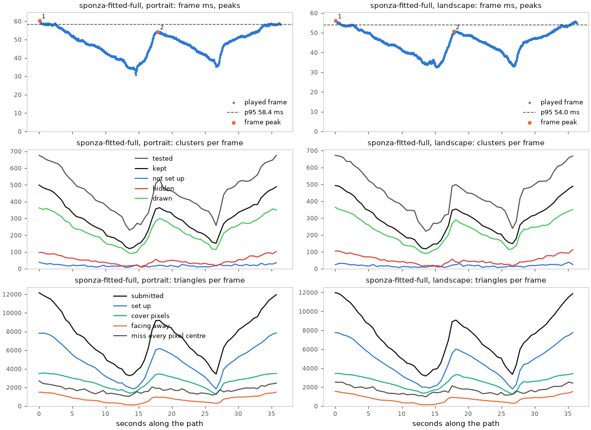
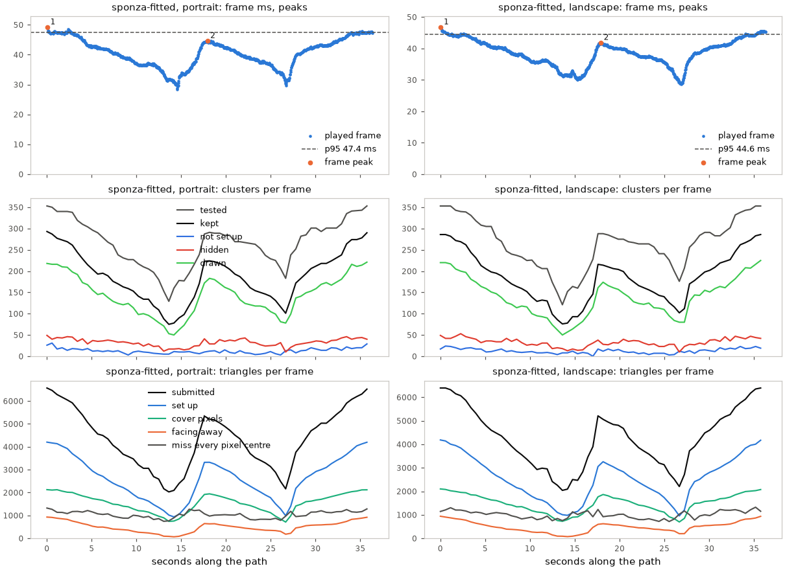
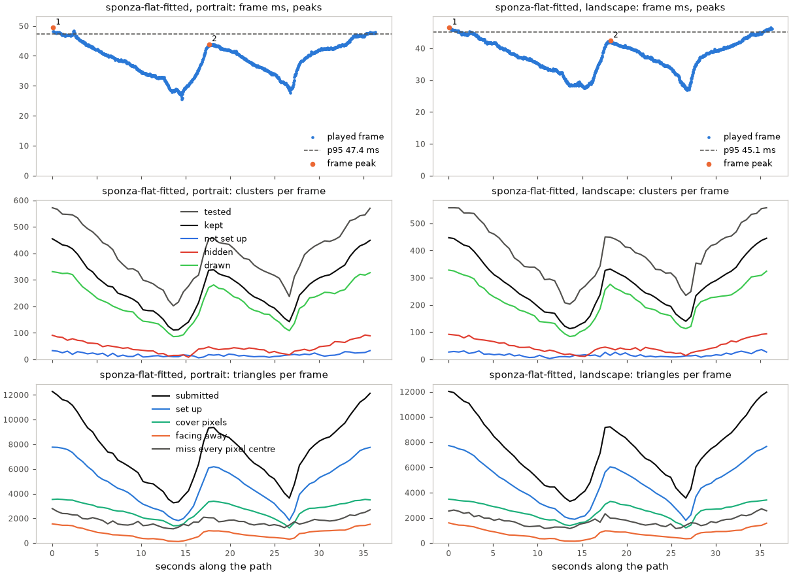
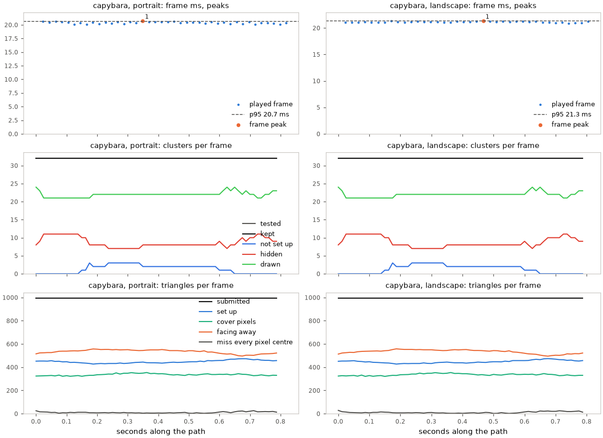
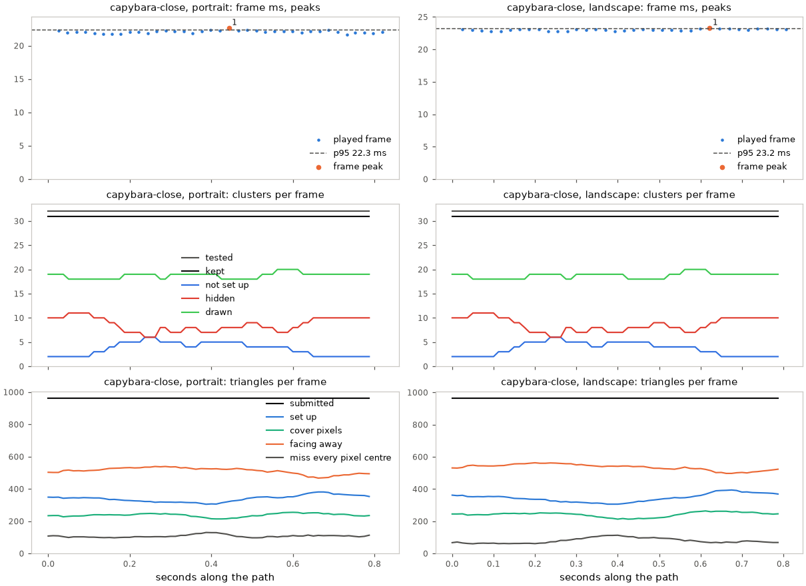
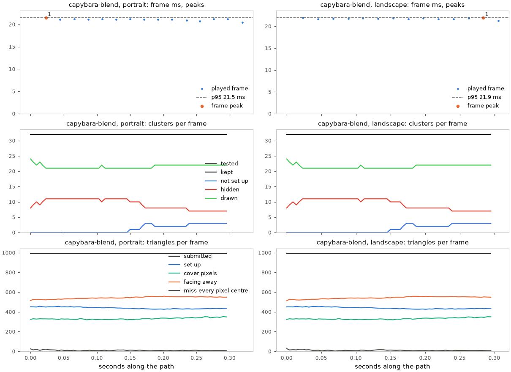
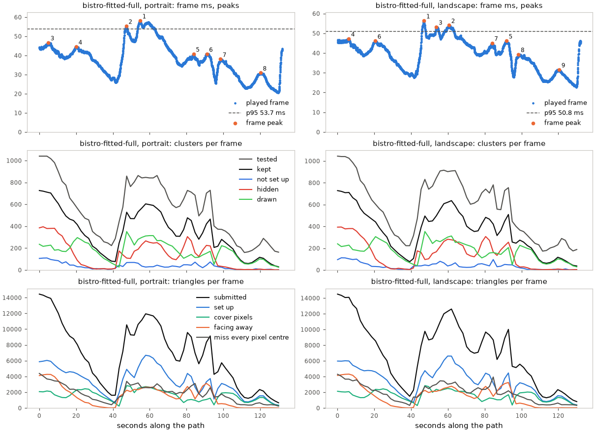

#### Frame peaks, ranked

One played frame per peak along the looping path, its slowest, ranked by wall time. A peak counts
when it stands 8% of its height above the higher of its two saddles.
Stage ms and counts come from replaying each pose paused;
Why compares them with the median of the 64 poses spaced evenly along the path (896 of 896 read).

| Scene | Quarter | Rank | Path s | Frame ms | Prominence ms | r3d.cull ms | r3d.transform ms | r3d.draw ms | r3d.upscale ms | Clusters tested / kept / hidden / drawn | Triangles submitted / set up / cover / miss / away | Why |
|---|---|---:|---:|---:|---:|---:|---:|---:|---:|---|---|---|
| sponza-fitted-full | portrait | 1 | 0.07 | 60.3 | 29.5 | 1.43 | 3.35 | 40.74 | 2.54 | 676 / 498 / 96 / 361 | 12155 / 7793 / 3474 / 2705 / 1497 | r3d.draw +7.7 ms; clusters hidden ×2.21 median |
| sponza-fitted-full | portrait | 2 | 17.89 | 54.3 | 18.9 | 1.22 | 2.48 | 37.40 | 2.57 | 518 / 359 / 47 / 292 | 9201 / 6146 / 3463 / 1927 / 907 | r3d.draw +4.4 ms; triangles set up ×1.27 median |
| sponza-fitted-full | landscape | 1 | 0.06 | 56.2 | 23.6 | 1.44 | 3.30 | 37.28 | 2.54 | 672 / 493 / 102 / 366 | 11973 / 7736 / 3409 / 2561 / 1547 | r3d.draw +7.1 ms; clusters hidden ×2.27 median |
| sponza-fitted-full | landscape | 2 | 17.81 | 50.7 | 17.5 | 1.17 | 2.47 | 34.04 | 2.52 | 499 / 355 / 49 / 280 | 9099 / 5877 / 3247 / 2042 / 926 | r3d.draw +3.9 ms; triangles submitted ×1.29 median |
| sponza-fitted | portrait | 1 | 0.05 | 49.2 | 20.9 | 1.09 | 1.90 | 31.49 | 2.62 | 353 / 293 / 43 / 219 | 6568 / 4200 / 2134 / 1339 / 916 | r3d.draw +5.4 ms; triangles facing away ×1.86 median |
| sponza-fitted | portrait | 2 | 17.92 | 44.6 | 14.8 | 0.94 | 1.47 | 28.69 | 2.64 | 291 / 222 / 39 / 172 | 5245 / 3338 / 1944 / 998 / 618 | r3d.draw +2.6 ms; triangles set up ×1.26 median |
| sponza-fitted | landscape | 1 | 0.05 | 46.7 | 18.0 | 1.09 | 1.86 | 29.47 | 2.62 | 353 / 286 / 48 / 220 | 6394 / 4178 / 2104 / 1154 / 935 | r3d.draw +5.4 ms; triangles facing away ×1.91 median |
| sponza-fitted | landscape | 2 | 17.90 | 41.8 | 11.8 | 0.94 | 1.50 | 26.50 | 2.64 | 289 / 219 / 33 / 174 | 5214 / 3248 / 1848 / 997 / 624 | r3d.draw +2.5 ms; triangles set up ×1.28 median |
| sponza-flat-fitted | portrait | 1 | 0.05 | 49.5 | 23.9 | 1.48 | 2.90 | 30.36 | 2.53 | 572 / 455 / 86 / 333 | 12279 / 7766 / 3502 / 2798 / 1545 | r3d.draw +6.3 ms; clusters hidden ×2.10 median |
| sponza-flat-fitted | portrait | 2 | 17.61 | 43.9 | 16.2 | 1.14 | 2.30 | 27.31 | 2.58 | 455 / 336 / 48 / 269 | 9326 / 6080 / 3335 / 2057 / 996 | r3d.draw +3.3 ms; triangles facing away ×1.28 median |
| sponza-flat-fitted | landscape | 1 | 0.05 | 46.5 | 19.6 | 1.41 | 2.81 | 28.79 | 2.59 | 557 / 447 / 85 / 333 | 12026 / 7732 / 3456 / 2532 / 1597 | r3d.draw +5.9 ms; triangles facing away ×2.09 median |
| sponza-flat-fitted | landscape | 2 | 18.16 | 42.4 | 14.9 | 1.15 | 2.20 | 26.34 | 2.58 | 449 / 332 / 46 / 270 | 9214 / 6058 / 3296 / 1962 / 956 | r3d.draw +3.4 ms; triangles submitted ×1.28 median |
| capybara | portrait | 1 | 0.35 | 20.7 | 0.6 | 0.23 | 0.20 | 5.47 | 2.58 | 32 / 32 / 8 / 22 | 994 / 442 / 351 / 4 / 546 | r3d.upscale +0.1 ms; triangles covering ×1.04 median |
| capybara | landscape | 1 | 0.47 | 21.3 | 0.4 | 0.22 | 0.20 | 6.11 | 2.63 | 32 / 32 / 8 / 22 | 994 / 442 / 333 / 9 / 541 | r3d.draw +0.2 ms; triangles facing away ×1.00 median |
| capybara-close | portrait | 1 | 0.44 | 22.6 | 1.0 | 0.24 | 0.24 | 7.18 | 2.73 | 32 / 31 / 8 / 18 | 962 / 324 / 215 / 113 / 523 | r3d.upscale +0.1 ms; triangles missed ×1.07 median |
| capybara-close | landscape | 1 | 0.62 | 23.3 | 0.5 | 0.24 | 0.20 | 7.93 | 2.73 | 32 / 31 / 9 / 19 | 962 / 379 / 261 / 67 / 514 | r3d.upscale +0.1 ms; clusters hidden ×1.12 median |
| capybara-blend | portrait | 1 | 0.02 | 21.5 | 1.1 | 0.21 | 0.20 | 5.34 | 2.54 | 32 / 32 / 11 / 21 | 994 / 449 / 329 / 21 / 522 | r3d.upscale +0.1 ms; triangles missed ×2.33 median |
| capybara-blend | landscape | 1 | 0.28 | 21.9 | 0.7 | 0.21 | 0.20 | 5.92 | 2.73 | 32 / 32 / 7 / 22 | 994 / 432 / 346 / 8 / 552 | r3d.upscale +0.1 ms; triangles covering ×1.05 median |
| bistro-fitted-full | portrait | 1 | 54.79 | 58.1 | 37.6 | 1.83 | 4.39 | 39.92 | 2.49 | 896 / 567 / 200 / 309 | 11280 / 5805 / 2668 / 2976 / 2494 | r3d.draw +18.5 ms; clusters drawn ×1.80 median |
| bistro-fitted-full | portrait | 2 | 47.25 | 55.3 | 8.3 | 1.91 | 4.51 | 35.73 | 2.48 | 932 / 576 / 133 / 356 | 11638 / 5152 / 2862 / 3955 / 2517 | r3d.draw +14.3 ms; triangles missed ×2.18 median |
| bistro-fitted-full | portrait | 3 | 4.85 | 46.7 | 20.9 | 1.69 | 5.74 | 26.47 | 2.43 | 1009 / 734 / 385 / 239 | 14497 / 6261 / 2225 / 3891 / 4238 | r3d.draw +5.0 ms; clusters hidden ×3.41 median |
| bistro-fitted-full | portrait | 4 | 20.05 | 44.6 | 6.4 | 1.28 | 3.39 | 26.77 | 2.42 | 583 / 429 / 98 / 292 | 8330 / 4440 / 2350 / 2240 / 1378 | r3d.draw +5.3 ms; clusters drawn ×1.70 median |
| bistro-fitted-full | portrait | 5 | 83.86 | 40.8 | 6.3 | 1.56 | 3.31 | 23.25 | 2.61 | 719 / 422 / 212 / 157 | 8500 / 3498 / 1138 / 3297 / 1647 | r3d.draw +1.8 ms; clusters hidden ×1.88 median |
| bistro-fitted-full | portrait | 6 | 91.02 | 40.8 | 5.9 | 1.45 | 3.29 | 23.80 | 2.48 | 705 / 432 / 224 / 161 | 8584 / 3463 / 1128 / 1972 / 3065 | r3d.draw +2.4 ms; triangles facing away ×2.18 median |
| bistro-fitted-full | portrait | 7 | 98.40 | 38.1 | 12.7 | 0.85 | 2.19 | 21.72 | 2.30 | 369 / 280 / 50 / 210 | 5733 / 3037 / 1755 / 1872 / 581 | r3d.draw +0.3 ms; clusters drawn ×1.22 median |
| bistro-fitted-full | portrait | 8 | 120.26 | 30.9 | 8.1 | 0.62 | 0.93 | 16.74 | 2.38 | 242 / 120 / 9 / 105 | 2407 / 1608 / 1378 / 629 / 17 | r3d.upscale -0.1 ms; triangles covering ×0.88 median |
| bistro-fitted-full | landscape | 1 | 47.03 | 56.4 | 33.7 | 1.86 | 4.48 | 36.13 | 2.52 | 918 / 570 / 127 / 377 | 11402 / 5198 / 2972 / 3652 / 2537 | r3d.draw +12.8 ms; clusters drawn ×2.05 median |
| bistro-fitted-full | landscape | 2 | 60.58 | 54.1 | 7.0 | 1.67 | 4.85 | 33.98 | 2.44 | 907 / 623 / 280 / 307 | 12355 / 6716 / 2563 / 2891 / 2684 | r3d.draw +10.6 ms; clusters hidden ×2.12 median |
| bistro-fitted-full | landscape | 3 | 53.73 | 53.2 | 5.8 | 1.79 | 3.94 | 34.73 | 2.48 | 851 / 503 / 159 / 280 | 9956 / 4710 / 2349 / 3121 / 2123 | r3d.draw +11.4 ms; triangles missed ×1.63 median |
| bistro-fitted-full | landscape | 4 | 6.11 | 47.3 | 19.6 | 1.86 | 5.67 | 27.08 | 2.42 | 997 / 736 / 396 / 238 | 14608 / 6210 / 2118 / 3937 / 4351 | r3d.draw +3.7 ms; clusters hidden ×3.00 median |
| bistro-fitted-full | landscape | 5 | 91.83 | 46.2 | 7.7 | 1.55 | 3.77 | 28.79 | 2.50 | 717 / 487 / 237 / 206 | 9551 / 4301 / 1688 / 2058 / 3111 | r3d.draw +5.4 ms; triangles facing away ×2.10 median |
| bistro-fitted-full | landscape | 6 | 20.47 | 46.1 | 7.7 | 1.35 | 3.40 | 28.21 | 2.51 | 623 / 445 / 109 / 302 | 8629 / 4617 / 2410 / 2305 / 1481 | r3d.draw +4.9 ms; clusters drawn ×1.64 median |
| bistro-fitted-full | landscape | 7 | 83.97 | 45.1 | 6.0 | 1.56 | 3.55 | 26.99 | 2.54 | 778 / 459 / 228 / 167 | 9243 / 4046 / 1318 / 3310 / 1805 | r3d.draw +3.6 ms; triangles missed ×1.73 median |
| bistro-fitted-full | landscape | 8 | 98.35 | 39.3 | 11.4 | 0.86 | 2.16 | 23.50 | 2.33 | 367 / 280 / 47 / 216 | 5714 / 3269 / 1765 / 1545 / 666 | r3d.draw +0.1 ms; clusters drawn ×1.17 median |
| bistro-fitted-full | landscape | 9 | 120.49 | 31.6 | 6.2 | 0.65 | 0.87 | 17.32 | 2.34 | 259 / 114 / 8 / 102 | 2293 / 1629 / 1403 / 469 / 33 | r3d.upscale -0.1 ms; triangles covering ×0.86 median |

### Overdraw at the frame peaks

Each replayed pose of every row that is a scene drawn by the host renderer through the overdraw view. Tested counts every span that reached a pixel, written every one that won its depth test, per pixel drawn.
Path percentile places a peak's tested layers among the evenly spaced poses' (100: none had more).

| Scene | Quarter | Rank | Path s | Frame ms | Tested / px | Written / px | Most tested | Most written | Path percentile |
|---|---|---:|---:|---:|---:|---:|---:|---:|---:|
| sponza-fitted-full | portrait | 1 | 0.07 | 60.3 | 2.44 | 1.31 | 22 | 8 | 81 |
| sponza-fitted-full | portrait | 2 | 17.89 | 54.3 | 2.34 | 1.35 | 16 | 6 | 69 |
| sponza-fitted-full | landscape | 1 | 0.06 | 56.2 | 2.63 | 1.43 | 19 | 10 | 95 |
| sponza-fitted-full | landscape | 2 | 17.81 | 50.7 | 2.34 | 1.32 | 15 | 6 | 41 |
| sponza-fitted | portrait | 1 | 0.05 | 49.2 | 2.50 | 1.49 | 15 | 6 | 70 |
| sponza-fitted | portrait | 2 | 17.92 | 44.6 | 2.52 | 1.40 | 12 | 6 | 77 |
| sponza-fitted | landscape | 1 | 0.05 | 46.7 | 2.64 | 1.61 | 15 | 9 | 86 |
| sponza-fitted | landscape | 2 | 17.90 | 41.8 | 2.49 | 1.38 | 13 | 7 | 33 |
| sponza-flat-fitted | portrait | 1 | 0.05 | 49.5 | 2.48 | 1.36 | 19 | 7 | 91 |
| sponza-flat-fitted | portrait | 2 | 17.61 | 43.9 | 2.34 | 1.35 | 15 | 6 | 58 |
| sponza-flat-fitted | landscape | 1 | 0.05 | 46.5 | 2.61 | 1.49 | 19 | 10 | 91 |
| sponza-flat-fitted | landscape | 2 | 18.16 | 42.4 | 2.32 | 1.36 | 17 | 6 | 31 |
| capybara | portrait | 1 | 0.35 | 20.7 | 1.28 | 1.25 | 7 | 4 | 91 |
| capybara | landscape | 1 | 0.47 | 21.3 | 1.27 | 1.24 | 8 | 3 | 80 |
| bistro-fitted-full | portrait | 1 | 54.79 | 58.1 | 3.46 | 1.27 | 14 | 5 | 94 |
| bistro-fitted-full | portrait | 2 | 47.25 | 55.3 | 3.14 | 1.28 | 18 | 5 | 89 |
| bistro-fitted-full | portrait | 3 | 4.85 | 46.7 | 2.27 | 1.21 | 14 | 6 | 42 |
| bistro-fitted-full | portrait | 4 | 20.05 | 44.6 | 2.67 | 1.31 | 14 | 7 | 64 |
| bistro-fitted-full | portrait | 5 | 83.86 | 40.8 | 2.89 | 1.54 | 15 | 7 | 75 |
| bistro-fitted-full | portrait | 6 | 91.02 | 40.8 | 3.41 | 1.62 | 14 | 7 | 94 |
| bistro-fitted-full | portrait | 7 | 98.40 | 38.1 | 2.62 | 1.39 | 12 | 7 | 64 |
| bistro-fitted-full | portrait | 8 | 120.26 | 30.9 | 2.03 | 1.22 | 8 | 6 | 11 |
| bistro-fitted-full | landscape | 1 | 47.03 | 56.4 | 3.22 | 1.34 | 17 | 7 | 89 |
| bistro-fitted-full | landscape | 2 | 60.58 | 54.1 | 3.64 | 1.43 | 15 | 6 | 98 |
| bistro-fitted-full | landscape | 3 | 53.73 | 53.2 | 3.37 | 1.30 | 15 | 5 | 94 |
| bistro-fitted-full | landscape | 4 | 6.11 | 47.3 | 2.34 | 1.24 | 14 | 5 | 44 |
| bistro-fitted-full | landscape | 5 | 91.83 | 46.2 | 3.26 | 1.60 | 13 | 7 | 91 |
| bistro-fitted-full | landscape | 6 | 20.47 | 46.1 | 2.78 | 1.38 | 16 | 7 | 70 |
| bistro-fitted-full | landscape | 7 | 83.97 | 45.1 | 2.89 | 1.54 | 15 | 7 | 73 |
| bistro-fitted-full | landscape | 8 | 98.35 | 39.3 | 2.90 | 1.44 | 10 | 6 | 73 |
| bistro-fitted-full | landscape | 9 | 120.49 | 31.6 | 2.02 | 1.22 | 7 | 5 | 11 |

#### Is a frame peak overdraw-heavy?

Over the evenly spaced poses, ρ ranks each pose's replayed ms against its tested layers and its triangles set up: whichever is higher follows the frame time more closely.

| Scene | Quarter | Path tested / px, median | Peak tested / px, median | Peak path percentile, median | ρ ms ~ layers | ρ ms ~ triangles set up | Follows |
|---|---|---:|---:|---:|---:|---:|---|
| sponza-fitted-full | portrait | 2.27 | 2.39 | 75 | +0.82 | +1.00 | triangles set up |
| sponza-fitted-full | landscape | 2.42 | 2.49 | 68 | +0.76 | +0.99 | triangles set up |
| sponza-fitted | portrait | 2.42 | 2.51 | 73 | +0.67 | +0.99 | triangles set up |
| sponza-fitted | landscape | 2.52 | 2.56 | 59 | +0.62 | +0.99 | triangles set up |
| sponza-flat-fitted | portrait | 2.30 | 2.41 | 74 | +0.80 | +0.99 | triangles set up |
| sponza-flat-fitted | landscape | 2.45 | 2.46 | 61 | +0.74 | +0.99 | triangles set up |
| capybara | portrait | 1.28 | 1.28 | 91 | +0.24 | +0.22 | layers |
| capybara | landscape | 1.26 | 1.27 | 80 | +0.32 | +0.01 | layers |
| bistro-fitted-full | portrait | 2.37 | 2.78 | 70 | +0.77 | +0.94 | triangles set up |
| bistro-fitted-full | landscape | 2.44 | 2.90 | 73 | +0.84 | +0.90 | triangles set up |

Sources:

- `frame-profile-1-board.log`
- `frame-peak-overdraw.tsv`
<!-- /generated: frame-timing-profiles -->
