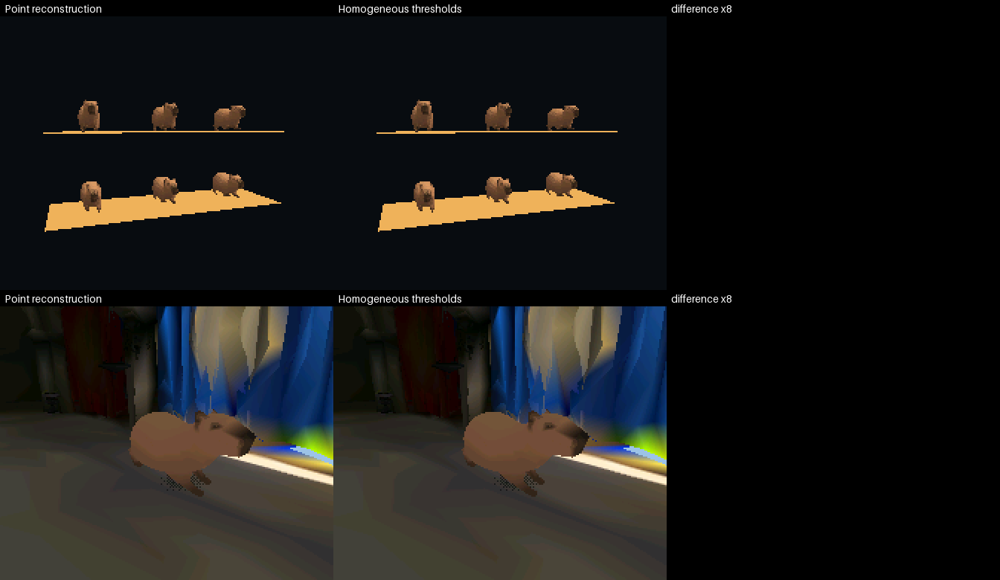

# Contact discs



The sheet compares point reconstruction with homogeneous Bayer thresholds.
Its difference maps are black: the captured stress and capybara-sponza frames agree.

`contact_blob_draw()` clips the disc's enclosing plane square against near depth.
Projected polygon edges bound each row. Off-screen and behind-camera footprints visit no pixels.
The inner loop compares homogeneous squared distance with a precomputed radius per Bayer threshold.

The radius table in `contact_blob.c` stores `sqrt(threshold / BAYER4_LEVELS)`.
Strength scales those radii once per blob. Pixel decisions need no divide, square root or falloff LUT.
Depth bias, Bayer phase and `rgb565be_half()` determine visibility and colour.

## Host checks

Each scene is sampled at 100 ms intervals in portrait and landscape, with the host's warm-up.
The point-reconstruction comparison has no changed pixels across either capture.
The maximum sampled absolute coverage error is below 0.000004 for both scenes.

| Scene | Portrait visited-pixel reduction | Landscape visited-pixel reduction |
|---|---:|---:|
| `stress-skinned-sh-blobs` | 11.33× | 7.68× |
| `capybara-sponza` | 2.92× | 2.81× |

These ratios describe row-loop visits, not device runtime. Host timings include blob setup;
a smaller visited count can increase time per visited pixel while reducing total time.
Device timings belong to the board perf suites.

```sh
sh launcher/main/apps/render_lab/tools/render_lab_render_host.sh --build-only -o /tmp/blob-host
/tmp/blob-host/render_lab_render --scene stress-contact-blobs --quarter 1 --no-hud \
    --frames 60 --dt 100 --video /tmp/contact-blobs.avi -o /tmp/contact-blobs.bmp
```

## Board scope

`stress-contact-blobs` draws static floor pads with contact discs under the near camera swing.
It shares the generated plane and copy-layout owners with other stress presets.
Its `run_stress_perf_suite` goal rows are zero until board measurements peg them.

`run_framegen_perf_suite` times the single disc in `capybara-sponza`.
The `plain` case measures its ordinary frame; the other cases exercise frame generation and resolution.

```sh
bash .dev/scripts/board-job.sh -- autana suite run_stress_perf_suite --flash --test stress-contact-blobs
bash .dev/scripts/board-job.sh -- autana suite run_framegen_perf_suite --flash --test capybara-sponza/plain
```
