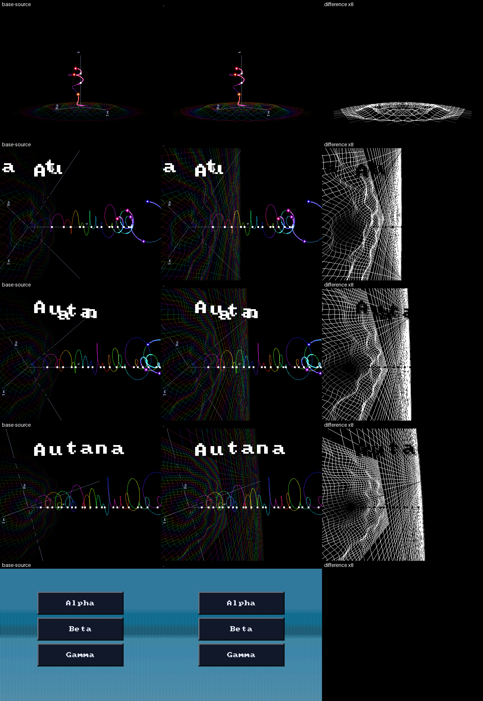
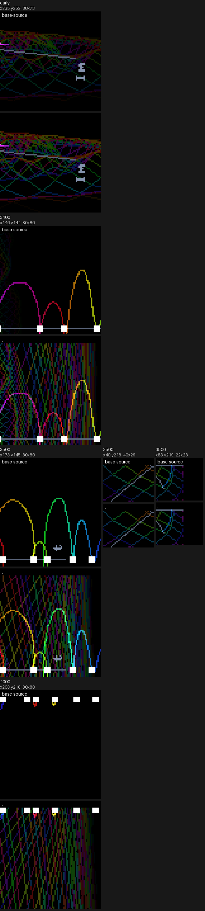
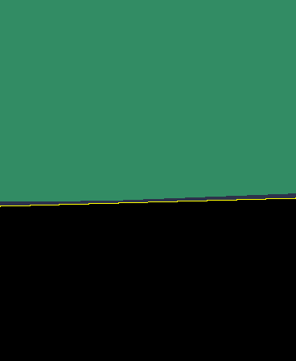
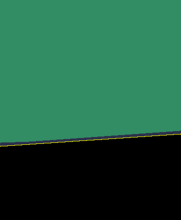

# Boot Anim

| File | Purpose |
|---|---|
| [report_boot_anim_perf.py](report_boot_anim_perf.py) | Formats a boot animation performance capture. |
| [report_boot_anim_perf.sh](report_boot_anim_perf.sh) | Captures and reports boot animation performance. |
| [plane_tilt.py](plane_tilt.py) | Tilts the space toward the camera over a stretch of the boot clip while the t line keeps its place on screen. |

## Where the animation lives

| File | Holds | Regenerate |
|---|---|---|
| `main/boot/boot_anim_timeline.json` | Timing, scalar settings and baked floor tables; everything but camera and space motion | `python tools/gen/gen_boot_anim_timeline.py main/boot/boot_anim_timeline.json main/boot/boot_anim_motion.glb > main/boot/boot_anim_timeline.h` |
| `main/boot/boot_anim_motion.glb` | The camera and the space: a glTF animation named `boot_motion` with nodes `camera` and `space`, authored in any glTF tool. Its last turn (3.1 to 4.3 s) carries a 25 degree tilt toward the camera | authored, then `python tools/boot_anim/plane_tilt.py main/boot/boot_anim_motion.glb -25 3.1 4.3`; the tilt adds to what the clip holds |
| `main/boot/boot_anim_motion.anim.toml` | Names that animation as the boot clip, baked into its own asset pack | `python tools/r3d/build_pack.py -o <dir>` (the firmware build runs it) |
| `main/boot/boot.png` | The photograph the animation crossfades to, drawn in the 448 x 368 reading frame | authored |
| `main/boot/boot.image.toml` | Names that photograph as the boot picture, turned into the panel's frame and baked into its own asset pack | `python tools/r3d/build_pack.py -o <dir>` (the firmware build runs it) |

`boot_anim_motion.c` reads the clip from its pack when boot starts; without
it (no assets partition, a bad pack, a malformed clip) the camera and space
hold an authored rest pose and the animation still draws. Boot reads the
picture (`boot_anim_photo.c`) on the second frame, one of the cheapest, so
checking its 330 KB pack neither delays the first frame nor stalls the
crossfade; without it the scene
stays where the photograph would have covered it. `boot_anim.h` samples the tracks with the engine's [animation tracks](../../../docs/Animation-Tracks.md) and converts each
frame's values to a `transformf_t` in `anim/anim_transform.h`. The space's
rotation is a quaternion slerp between its keys. Frames render on a host with
`tools/render/scenes/boot_anim_render_host.sh` (`--video` for the whole
animation).

## Baked floor

`gen_boot_anim_timeline.py` emits the floor tables into
`main/boot/boot_anim_timeline.h`, together with the timeline constants.
`ripple_impact_ms` starts an outward Gaussian ring packet, with decay set by
`ripple_decay_ms`. Wavelength, speed, packet width in wavelengths and height
are authored by the top-level `ripple_*` settings. The directional `swell`
entries contain wavelength, period, direction in degrees and weight;
`swell_height_m`, `swell_start_ms` and `swell_in_ms` set their shared envelope.

Distance bands and radial attenuation use quadrant symmetry. A spatial
ripple-shape lookup combines with interpolated time samples. Separable
swell phase offsets use the mesh's row and column coordinates. The host
suite checks the resulting heights against direct floating-point evaluation;
its tolerance and observed maximum error are printed by
`test_baked_floor_matches_direct_float`.

The camera-plane walk retains fractional bits until projection, preserving
the narrow transform's rounding. Views outside its input bounds use the full
transform. Mesh rows and columns share endpoints through `DRAW_LINE_OPEN`;
clipped starts retain their first pixel. Screen outcodes reject invisible
edges before colour setup.

The total height has a radial envelope authored by
`swell_flat_start_m`: both swell and the ripple tail reach exactly zero at
the mesh boundary. The ripple's leading crest stays inside that boundary
through the animation; its Gaussian tail is included in the envelope.

Outside the mesh, straight lines at height zero extend the lattice.
`far_line_stride` selects every kth mesh line. Outer offsets become sparser
by `far_spacing_growth` at successive multiples of the mesh reach.
`far_reach_m` bounds both axes. The generator bakes offsets, radial colour
bands and geometrically spaced segment endpoints; `far_segments` controls
the samples per tail. Geometric spacing concentrates colour changes near
the mesh, where intervals occupy more pixels. Whole-line near-plane and
screen clipping precede segment setup. The mesh and extensions share one
radial fade, with the existing opacity ceiling.





[Whole-animation comparison](far_compare/animation.mp4) and
[measurements](far_compare/measurements.json) contain the instruction rows,
line calls, near alpha samples, table sizes and validation results. The
reference identities and settings are recorded with those measurements.

The current camera leaves the horizon inside the screen. A farther plane
cannot cover rays that meet it behind the camera. Coverage measures the
plane's area, including spaces between grid lines, by intersecting native
pixel-centre rays with the flat plane. The measurement uses the asset
pack's engine-frame conversion and the renderer's Q9 camera matrix.
The masks show the finite floor in green and the remaining infinite-plane
area in blue; yellow marks the horizon.





Regenerate the comparison from the repository root with absolute output
paths:

```sh
bash launcher/tools/render/render_compare.sh --script launcher/tools/render/scenes/boot_anim_render_host.sh \
  --render 3100 "3100 --quarter 1" --render 3500 "3500 --quarter 1" \
  --render 4000 "4000 --quarter 1" --render animation "0 --quarter 1 --frames 184 --dt 30" \
  --video --fps 33 --crops 3 4a3455810 . -o /absolute/path/to/comparison
```

Instruction measurements use the on-request `run_boot_floor_cost_suite`:

```sh
python .dev/scripts/quiet.py -- bash launcher/test/run_tests.sh --sanitize
AUTANA_ASSET_DIR=launcher/test/build/assets launcher/test/build/host_tests --run run_boot_floor_cost_suite
python .dev/scripts/quiet.py -- bash launcher/test/run_qemu_tests.sh --suite run_boot_floor_cost_suite --icount --timeout 600
```

The ink-zero row measures near-mesh traversal, projection and rejection,
including the flat spokes; it skips the far lattice. The ordinary row
measures the complete floor. Point and horizontal-line rows calibrate an
estimate of setup and pixel costs; varied slopes, clipping and endpoint
flags make that split approximate.
