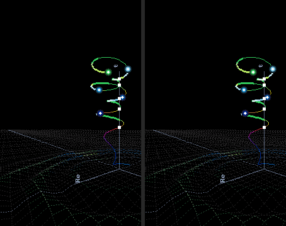
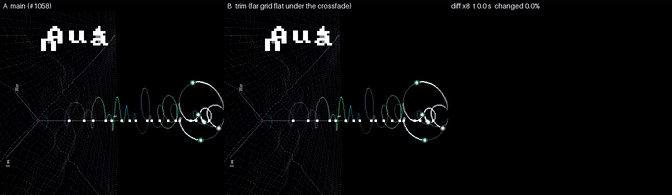
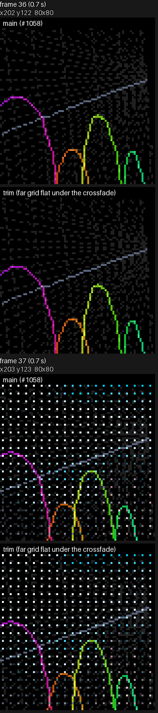
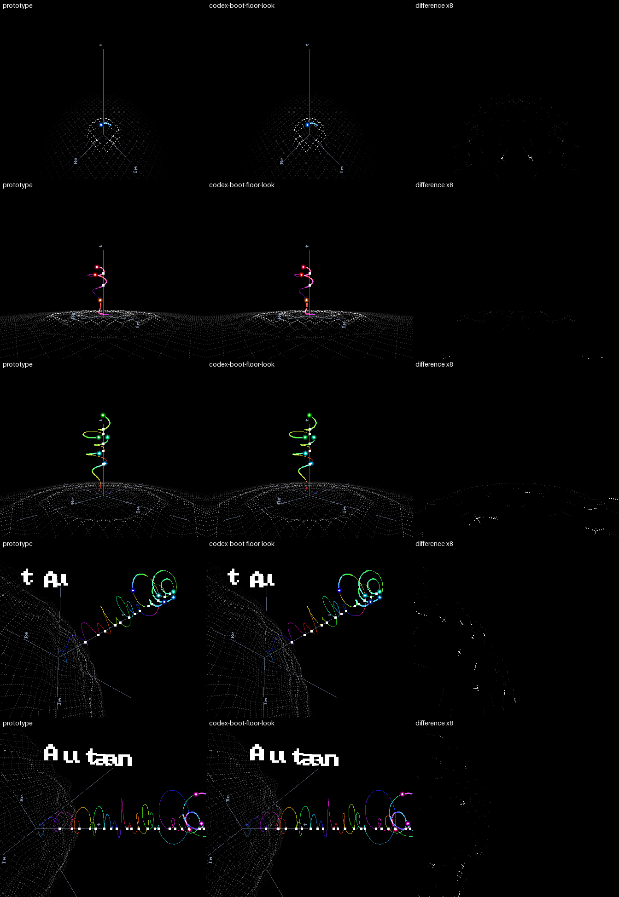
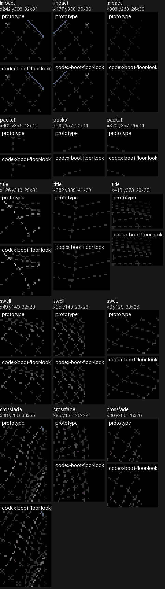

# Boot Anim

| File | Purpose |
|---|---|
| [report_boot_anim_perf.py](report_boot_anim_perf.py) | Formats a boot animation performance capture. |
| [report_boot_anim_perf.sh](report_boot_anim_perf.sh) | Captures and reports boot animation performance. |
| [plane_tilt.py](plane_tilt.py) | Tilts the space toward the camera over a stretch of the boot clip while the t line keeps its place on screen. |

## Where the animation lives

| File | Holds | Regenerate |
|---|---|---|
| `main/boot/boot_anim_timeline.json` | Timing, scalar settings and baked floor tables; everything but camera and space motion | `python tools/gen/gen_boot_anim_timeline.py main/boot/boot_anim_timeline.json main/boot/boot_anim_motion.glb > main/boot/boot_anim_timeline.h` |
| `main/boot/boot_anim_motion.glb` | The camera and the space: a glTF animation named `boot_motion` with nodes `camera` and `space`, authored in any glTF tool. Its last turn (3.1 to 4.3 s) carries a 25 degree tilt toward the camera | authored, then `python tools/boot_anim/plane_tilt.py main/boot/boot_anim_motion.glb -25 3.1 4.3`; the tilt adds to what the clip holds |
| `main/boot/boot_anim_motion.anim.toml` | Names that animation as the boot clip, baked into its own asset pack | `python tools/r3d/build_pack.py -o <dir>` (the firmware build runs it) |
| `main/boot/boot.png` | The photograph the animation crossfades to, drawn in the 448 x 368 reading frame | authored |
| `main/boot/boot.image.toml` | Names that photograph as the boot picture, turned into the panel's frame and baked into its own asset pack | `python tools/r3d/build_pack.py -o <dir>` (the firmware build runs it) |

`boot_anim_motion.c` reads the clip from its pack when boot starts; without
it (no assets partition, a bad pack, a malformed clip) the camera and space
hold an authored rest pose and the animation still draws. Boot reads the
picture (`boot_anim_photo.c`) on the second frame, one of the cheapest, so
checking its 330 KB pack neither delays the first frame nor stalls the
crossfade; without it the scene
stays where the photograph would have covered it. `boot_anim.h` samples the tracks with the engine's [animation tracks](../../../docs/render/animation/Animation-Tracks.md) and converts each
frame's values to a `transformf_t` in `anim/anim_transform.h`. The space's
rotation is a quaternion slerp between its keys. Frames render on a host with
`tools/render/scenes/boot_anim_render_host.sh`; see [Watching a change](#watching-a-change).

## Watching a change

Edit `main/boot/boot_anim_timeline.json`, then from `launcher/`:

```sh
python tools/gen/gen_boot_anim_timeline.py main/boot/boot_anim_timeline.json main/boot/boot_anim_motion.glb > main/boot/boot_anim_timeline.h
./tools/render/scenes/boot_anim_render_host.sh --video
```

`whole.avi` in the render folder is the whole animation, upright as the
board is held. The other renders are pinned, so a change to what boot draws
fails the run until it is re-pinned with `--update-baseline`; `whole.avi`
renders first and is written either way.

## Baked floor

`gen_boot_anim_timeline.py` emits the floor tables into
`main/boot/boot_anim_timeline.h`, together with the timeline constants.
`ripple_impact_ms` starts a dispersive Gaussian packet. The group clock
`ripple_clock_s`, group speed, initial width, dispersion, source radius,
wavelength and height are top-level `ripple_*` settings. The calm centre's
radius fraction and delay are authored separately. The directional `swell`
entries contain wavelength, period, direction in degrees and weight;
`swell_height_m` and `swell_in_ms` set their shared envelope. The swell starts
at `title_start_ms`, together with the title's first letter.

Quadrant-symmetric tables hold node radii, distance bands and ripple phases.
Gaussian and smoothstep lookups combine with interpolated frame scalars;
separable swell phase offsets use the row and column coordinates. The host
suite checks the heights against direct floating-point evaluation; its
maximum error and tolerance are printed by `test_baked_floor_matches_direct_float`.

Edges use `floor_grey` at `grid_level`, turning toward a colour of the curve
with the squared positive ripple height divided by `crest_height_m`. The
colour is the stroke hue of the curve sample nearest the edge among those the
pen has drawn, from baked runs over every `crest_colour_stride`-th node. The
swell contributes no colour.

Arrival uses `grid_band_ms`; alpha stays full to `grid_edge_fade_fraction`
of the reach, then ramps to zero. `mesh_dash_on_px` and `mesh_dash_off_px`
set each line's pixel pattern through `DRAW_LINE_DASH`. Screen outcodes
reject invisible edges before colour setup.

The mesh lines on the axes keep the axes' colour and skip the edge fade. Past
the mesh they go on alone to `far_m`, still lifted by the ripple and the
swell, growing over `far_grow_ms` once the mesh has arrived, eased in by
`far_grow_power`. They end at the horizon, where the far grid converges.

The plane itself goes on past the mesh as straight grid lines: every
`far_line_cells`-th mesh line inside the mesh's edge, then the gap doubling
each time the distance grows by `far_line_growth`. They are cut to the circle of the floor's reach, so the plane
arrives radially; its outer `far_front` share fades in over
`far_front_steps` rings until the reach is complete. Near the horizon the
lines merge into a band.

The swell rides the far lines and the axis lines past the mesh, easing out
to flat at `far_swell_fade_m`. The far lines are sampled where they cross
the axis lines' sample circles, so the samples thin with distance. The
generator rejects a fade past the point where those samples are more than
half the shortest swell wavelength apart. The swell starts only once the
reach is complete, so the far front stays flat. The far lines lose it
again over `far_swell_out_ms` before `image_start_ms`, so they are flat
and cheap under the crossfade, where the photograph covers them; the axis
lines keep theirs.







The camera-plane walk retains fractional bits until projection. Views
outside its input bounds use the full transform. The comparison below aligns
the float reference's camera, photograph timing, swell start and constant grey
with these settings. Each row is reference, baked result and amplified pixel
difference; the crops enlarge the strongest differences.





The [capture notes](look_compare/README.md) identify reference controls
and the instruction-count measurements.

Instruction measurements use the on-request `run_boot_floor_cost_suite`:

```sh
python .dev/scripts/quiet.py -- bash launcher/test/run_tests.sh --sanitize
AUTANA_ASSET_DIR=launcher/test/build/assets launcher/test/build/host_tests --run run_boot_floor_cost_suite
python .dev/scripts/quiet.py -- bash launcher/test/run_qemu_tests.sh --suite run_boot_floor_cost_suite --icount --timeout 600
```

The ink-zero row bounds projection plus traversal and rejection. The ordinary row measures the complete floor. Point and
horizontal-line rows calibrate an estimate of setup and pixel costs; varied
slopes, clipping, dash lengths and endpoint flags make that split approximate.
