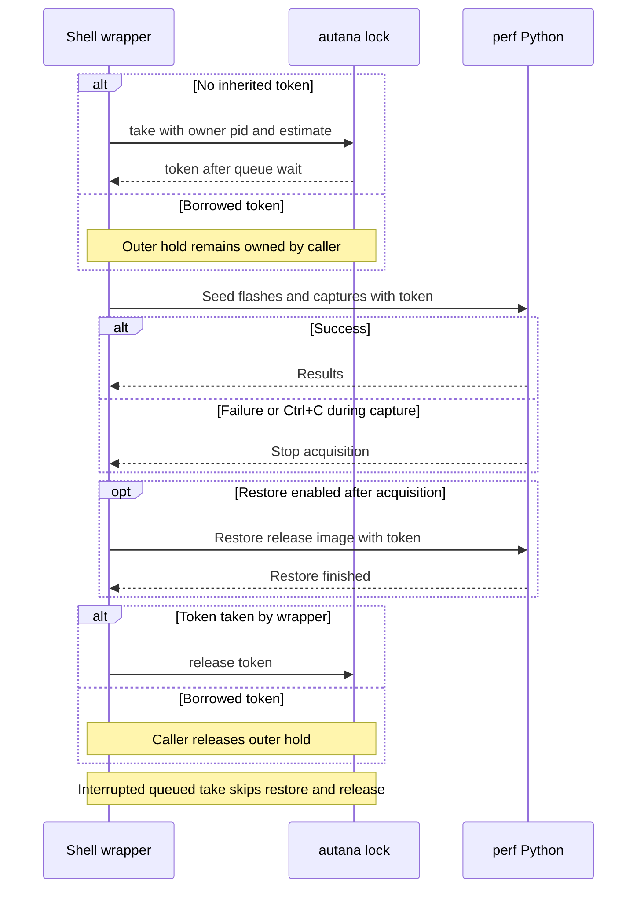
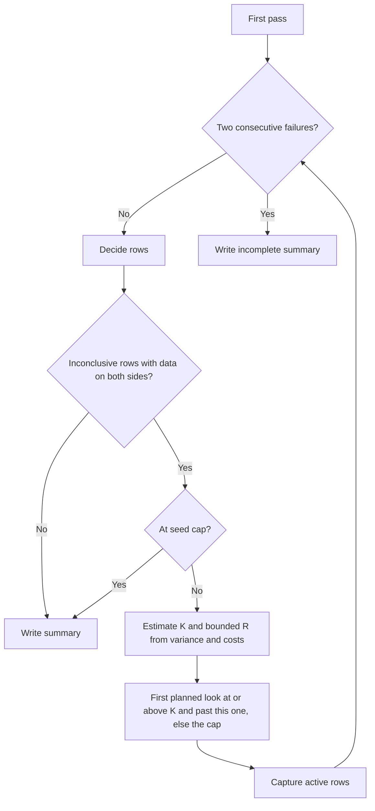
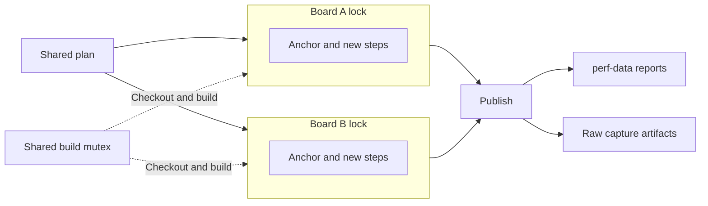
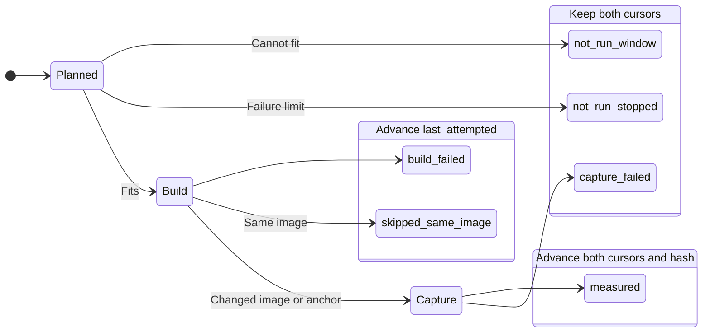

# Performance comparison

`perf_compare.sh A B` compares revisions using independent, random positive
layout seeds on each side. `A A` calibrates the same source with two distinct
seed sets. Arguments accept revisions or existing project directories.
The wrapper restores `origin/main`'s release image afterwards;
`--no-restore` omits that flash.

Capture comparisons require one USB serial throughout the input set.
A mixed set exits non-zero before comparison and lists each board's short
id, full serial and captures. A capture without board provenance is unknown:
unknown captures can be compared together, but cannot be mixed with a known
board. The shared identity check in `capture.py` reads board fields in saved
measurement records and the device capture index. Raw captures need matching
device index entries; seeded measurement and sweep records retain the serial.
A held comparison job routes every capture through the same board.

`autana status` shows the job name, estimated finish and queued starts.
Estimates use recorded flash and capture durations, with the configured capture
deadline and `DEFAULT_FLASH_SECONDS` in `perf_job.py` as fallbacks.
The comparison estimate covers its first scheduled pass: seeds per side,
calibration repeats, requests per capture and the restore flash when enabled.
Adaptive extra seeds can run longer. The sweep estimate uses its planned
flashes, rounds, knob points and inventory captures, plus the optional restore.



Each `--suite NAME TESTS TABLE` takes a registered suite name, comma-separated
test patterns (`-` for all), and a table command (`-` reads the capture's
`<row> both cores: mean <N>us`, `<row> one core: mean <N>us`,
`<row> mean <N>us` lines, or a `frame_profile:` row). Pattern width and count limits come
from each project's `launcher/test/suites.h`; a pattern over the width is
refused before any flash, and patterns over the count run as several requests
on the same flash. Each test must match patterns in one request only; a row
measured by two requests stops the comparison. Commands run from the current repository: `@CAPTURE@` and
`@TABLE@` become this flash's capture and table files, `@PROJECT@` the revision's
project tree. A table command requiring budgets must read them from that tree,
for example with `--source @PROJECT@/path/to/suite.c`.

```sh
launcher/tools/perf/perf_compare.sh A B -o comparison --rng-seed 42 \
  --suite SUITE TESTS -

launcher/tools/perf/perf_compare.sh A A -o calibration \
  --suite run_example_perf_suite frame_budget \
  'python3 path/to/report_performance.py @CAPTURE@ @TABLE@ --source @PROJECT@/path/to/suite.c'
```

`--send-a LINE` and `--send-b LINE` send console setup before every capture.
Each side's sequence should be idempotent: stop voices before starting a loop.
Use the same revision on both sides to measure runtime setup alone:

```sh
launcher/tools/perf/perf_compare.sh HEAD HEAD -o sound-comparison \
  --suite run_sponza_perf_suite flythrough - \
  --send-b 'sound stop all' --send-b 'sound play tap loop'
```

`--perf-scope` is forced for every seeded flash.
Captures, status checks and restore use `autana` on PATH; `--autana COMMAND`
overrides all three for a host replay.

## Measurement plan

The default RNG seed is a fresh draw. `--rng-seed` replays a recorded draw;
`plan.json`, `summary.md` and `comparison.json` record it. Every A/B pair
randomises which side flashes first, with distinct seeds across both sides.
`plan.json` records each flash's seed, side, runs, suites and any capture error.

The first pass takes the seed count needed for exact permutation resolution
at nominal alpha, repeats a subset to estimate run variance, and captures
the remaining seeds once. The summary states actual first-pass size, runs
per look, cap and run clamp. Run variance is pooled from repeated seeds;
every complete seed contributes a mean and layout estimate.



Planned looks double towards `--max-seeds` and end at the cap. Nominal alpha
is divided across planned looks, then split equally between Welch difference<sup>[[37]](../../../docs/Citations.md#37)</sup>
and TOST equivalence<sup>[[38]](../../../docs/Citations.md#38)</sup> families. Each family uses Holm adjustment<sup>[[39]](../../../docs/Citations.md#39)</sup> across rows,
including rows decided earlier. Permutation is an AND cross-check at nominal
alpha. Its Monte Carlo resample count keeps the add-one floor<sup>[[40]](../../../docs/Citations.md#40)</sup> well below that
alpha; settings exceeding the supported resample budget are refused before
measurement.

Measured build/flash/boot and run costs, sigma_run and sigma_flash feed
Kalibera-Jones<sup>[[41]](../../../docs/Citations.md#41)</sup> R and required K. K uses the per-look Holm share and one-sided
TOST alpha. R is clamped between 1 and `MAX_RUNS` (`perf_compare.py`), also
when the estimated layout variance is zero; the summary states the clamp.
A later flash uses the largest R recommendation among active rows.
For a filtered first pass, extra seeds re-run the subset of the user's own
patterns matching active tests. For an unfiltered first pass, capture test
ownership maps active rows to the shortest substrings unique among the tests
the unfiltered pass reported (PASS, FAIL and IGNORE result lines). Missing inventory,
unknown owners, or tests without a bounded unique substring fall back to the
user's filter.

Each suite's deadline is `--timeout` per requested run plus `--wait`.
Table commands also run with a deadline of `--timeout`. Status logs
bracket each flash; the boot id must match its project's seeded build id.
Later suites request that build id. Complete captures exiting 1 are kept;
other exit codes, incomplete captures, wrong builds and table errors are
failures. Two consecutive failures stop measurement, and so does a suite
whose first flash on each side gives no timing rows; that error names the
suite and its table. A stop writes the summary so far, with decisions and
errors, and marks it incomplete, as does any row not measured. A success
resets the failure count. Failed attempts consume the cap.

## Reading the result

Each complete seed mean is one independent observation. A row missing from
any run of a seed excludes that seed for that row; expected rows remain
visible even when a later flash omits them. The table shows arithmetic means,
medians of seed means, B/A, delta time and a Welch interval on log seed means.
The interval describes a geometric ratio, whereas B/A uses arithmetic means.
Instruction deltas use complete, unambiguous, non-overflowing counter pairs
from the look that decided the row.

No change means Holm-adjusted TOST equivalence within +/-threshold; regressed
or improved means a significant Welch difference with permutation agreement
that is not shown equivalent, so a move smaller than the threshold can still
be regressed.

A real move inside the threshold can be reported as **no change**, so to see
a small gain as **improved**, pass a `--threshold` below the gain you are
chasing (for example `--threshold 0.1` for a 0.3% target). A smaller threshold
needs more seeds per side; raise `--max-seeds` with it, or expect inconclusive
rows at the cap.

Both arithmetic and log-difference signs must agree on direction. **Added**
means B only and **removed** A only when every attempt on the other side
succeeded and its captures ran the row's owning test without printing the
row. An IGNORE result does not establish measured absence.
**Not measured** means missing or zero timings or no complete seed.
These rows receive no extra seeds.
**Inconclusive** rows with data on both sides alone receive more measurements,
and remain inconclusive when the cap is reached. Permutation n/a means there
is too little positive timing data to compute it. A/A calibration allows
inconclusive noisy rows; lack of significance does not establish equivalence.

Statistics, variance estimates, seed/build identities and capture records
are preserved beside the summary. Host tests use an injected runner:

```sh
python -m unittest discover -s launcher/tools/perf/tests
```

`phase_report.py` writes the phase tables for a reporter that turns one
device capture into Markdown: each phase's average per run, Total as fps,
then each run's min/max/avg/median/p95 per phase.

See [Layout-Noise.md](../../../docs/tools/Layout-Noise.md) for seeded builds
and pilot variance definitions.

## Sweep

`perf_sweep.sh` flashes one perf-scoped diagnostic image per build and layout
seed with `--hot-tunables` whenever a `--knob` is given. The plan records
this flag and the table header identifies live knobs. Each flash is one
capture of the first suite, which waits for the image to boot and is
discarded, so no point takes the first capture after a boot. Default device images
keep `TUNE_HOT` values constant. Every round visits the Cartesian product of knob values in a fresh,
recorded random order. The first build and first value of each knob form the
baseline. Each capture sets its point's knobs under its own lock
(`autana suite --set`), so whoever holds the board between two captures cannot
change what is measured. The wrapper restores `origin/main`'s release image
afterwards unless `--no-restore` is passed.

```sh
launcher/tools/perf/perf_sweep.sh --knob r3d_span.small_max_side=2,3,4 \
  --suite run_raster_scale_perf_suite counters - --runs 5
```

| Option | Meaning |
| --- | --- |
| `--out DIR` | Captures, plan and generated `sweep.md` / `sweep.json`; defaults to a temporary directory in the wrapper |
| `--build LABEL=REV` | Repeatable revision or directory; defaults to this project, labelled `here` |
| `--knob NAME=V1,V2,...` | Repeatable console tunable and integer values |
| `--suite NAME TESTS TABLE` | Repeatable suite, filters and report command with `@CAPTURE@`, `@TABLE@`, `@PROJECT@`; `-` reads raw metrics |
| `--seeds S1 S2 ...` | Distinct layout seeds; default `1` |
| `--runs R` | Rounds per flash; default `DEFAULT_RUNS` in `perf_sweep.py` |
| `--rng-seed N` | Replay the recorded point order |
| `--threshold PCT`, `--alpha P` | Equivalence margin and family error rate; defaults shared with `perf_compare.py` |
| `--timeout SECONDS`, `--wait SECONDS` | Capture and board queue deadlines |
| `--autana COMMAND` | Override acquisition, status checks and restore for host replay |
| `--dry-run` | Print flashes, capture count and point order without board access |
| `--no-restore` | Omit the wrapper's release restore |

The table has one row per metric every capture reported: timing rows, the
suite's own frame-cost stage averages, one-core span fields and per-call
counters. A knob point is compared with its build's baseline point on the same
images, so layout is shared and the interleaved runs are the observations; it
counts as improved or regressed when significant, beyond the threshold, and in
the same direction on every seed. A build is compared with the first build by
per-seed means, which carry layout noise; with one seed that comparison is
inconclusive. `seed_statistics.compare()` applies Welch, TOST, permutation
agreement and Holm across the table's cells.

`plan.json` and per-capture JSON retain failures; two consecutive capture
failures stop acquisition. Rebuild the generated report with
`python launcher/tools/perf/perf_sweep.py report DIR`.

Render perf captures force every timed render window through portrait and
landscape. Rows carry `quarter=portrait` or `quarter=landscape`; the quarter
is part of the metric name in comparisons, layout pilots and sweeps. Stage
and span metrics retain that identity too. Untagged captures retain their
unqualified row names, so comparisons do not silently pair them with tagged
rows. Single-viewport render documentation readers select portrait by default;
`dynres_report.py --quarter landscape` selects landscape explicitly.

## Nightly scoped chain

The same workflow runs docs-search retrieval evals alongside the board job:
hybrid on the GPU runner and lexical on hosted Linux, with scores in each job summary.

The workflow assigns first-parent commits on main by position modulo board
count. Each board repeats its last measured commit as an anchor and plans
new steps after `last_attempted`. A fresh board starts at its newest commit.



Builds are serialised across lanes and run at below-normal priority so the
host stays responsive.

A flash is skipped when the commit's image hash equals the same board's
previous measured image hash. Hashes are compared only within one board's
series, and an anchor is always measured.



Cursors retain the furthest first-parent position, including explicit ranges.
`last_measured` and `last_image_hash` identify the board's measured baseline.

The orphan `perf-data` branch stores
`scoped/<board>/<YYYY-MM-DD>-<HHMM>/night.json` and `<NN>-<sha12>.json` reports.
The directory uses the plan's local start time; the manifest's `night` is its date.

The manifest records step outcomes, cursors, image hashes, durations, and
self-test results. LNT v2 reports use the full USB serial as machine name,
the commit as `run.llvm_project_revision`, and timing samples in seconds.

For a short manual chain, create a data checkout and a shared plan, then run
each lane under its board's hold. `--from` includes that commit if assigned
to the lane; `--max-steps` limits new candidates and retains the anchor.

```sh
python launcher/tools/perf/nightly/scoped_chain.py plan \
  --boards BOARD_A BOARD_B --data DATA --out plan.json \
  --from SHA --max-steps 2
autana --board BOARD_A --wait 3600 lock run -- \
  python launcher/tools/perf/nightly/scoped_chain.py run \
  --plan plan.json --data DATA --board BOARD_A --lane 0/2 \
  --until 07:00 --out captures --suite SUITE - -
```

`--suite NAME TESTS TABLE` is perf_compare's triplet: suite name,
comma-separated test patterns or `-` for all, and table command or `-` for raw
timing lines. The workflow's `NIGHTLY_SUITES` supplies these triplets.

`--lane INDEX/COUNT` is this board's share of the plan. `plan.json` records
it per board; `lane-info --plan plan.json --board BOARD_A` prints it and its
estimated duration in seconds.

`QUEUE_AT`, `WINDOW_END`, and `SELFTEST_AT` set local times. Dispatch inputs
`queue_at`, `window_end`, and `selftest_at` override them; an empty dispatch
`queue_at` starts immediately. A dispatch holds boards until its window end or `max_steps`.

A step starts only if it fits before `WINDOW_END`, and a lane stops after
`CAPTURE_FAILURE_LIMIT` consecutive capture failures (`scoped_chain.py`).
Unattempted commits go to the same board's next night.

The nightly runs one lane per board `autana devices` lists as plugged in on
the runner, so plugging a board in or out changes the lanes. A board's first
night measures one commit as its baseline.

One board, the first one listed, also runs Board CI's steps
(`scripts/ci/board-steps.sh`: the self-test, then the console tests) at the first step boundary after `SELFTEST_AT`, or after its chain if that
ends first, inside the same hold.

Partial manifests are written after every step. Raw captures and result
directories are uploaded even when a lane fails.

## Real-time playback

`frame_profile:` rows time whole app frames while a clip plays; the render_lab
suite that emits them is described in its
[tools README](../../main/apps/render_lab/tools/README.md#frame-timing-profiles).

`frame_profile:` reports frame count and mean, median, p95, worst and best
wall times. Mean FPS is timed frames / total wall time; low FPS is 1/p95,
worst FPS is 1/worst frame time. `quarter=` identifies orientation.

The warm-up runs at dt 0 and is excluded from statistics. Its wall time
supplies the first clip advance. Each later frame advances by the previous
frame's wall time.

The capture parser compares mean microseconds for each scenario and quarter.
The fields are defined in `launcher/test/frame_profile.h`.

Pose-time parsers accept `t=...ms`; the `t=...s` form is for older captures.
