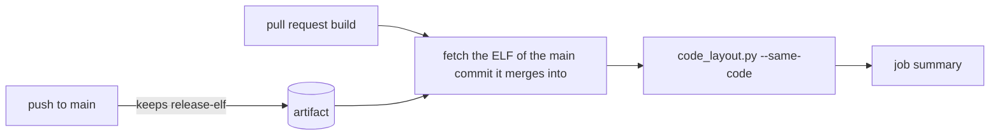

# Render

| File | Purpose |
|---|---|
| [render_host.c](render_host.c) | Runs a firmware drawing scene on the host and writes BMP frames. |
| [render_host.h](render_host.h) | Scene interface for host rendering. |
| [render_scene.sh](render_scene.sh) | Compiles, runs, and checks one host render scene. |
| [render_all_scenes.sh](render_all_scenes.sh) | Discovers and checks all host render scenes. |
| [scene_viewer.sh](scene_viewer.sh) | Builds and renders a scene file, selecting renderers with `--object NAME`; `--build-only -o DIR` returns the host path; `--deps` lists what it is compiled from; `--compare REV` or `DIR` writes the camera path as an A-against-B video and `--frame N` renders one frame of it. |
| [scene_path.py](scene_path.py) | Times and renders the camera path behind `scene_viewer.sh --compare` and `--frame`. |
| [doc_images_demo.sh](doc_images_demo.sh) | Makes the demo's bake, fidelity, import and small-fill images and measured CPU tables through the scene viewer; `--small-fill-only` selects the small-fill outputs. |
| [doc_tables.py](doc_tables.py) | Writes CPU tables from comparison logs, tunable listings and sweep captures, with scene and object names supplied as arguments. |
| [doc_import_examples.py](doc_import_examples.py) | Renders albedo and face-sampling examples from a supplied scene and renderer. |
| [physical_scene.py](physical_scene.py) | Copies a scene without its indirect look and occlusion settings, or in one study look (`--look`), for isolated bake studies. |
| [showcase.py](showcase.py) | Prints a scene's showcase, its first renderer: the one pictures of the whole scene draw. |
| [render_diff.py](render_diff.py) | Compares rendered and captured images. |
| [render_diff.sh](render_diff.sh) | Shell entry point for image comparisons. |
| [render_temporal.py](render_temporal.py) | Adds triangle-scale temporal metrics to video CSVs and composes labelled look-range videos. |
| [render_compare.py](render_compare.py) | Builds the A, B and difference sheet, the side-by-side video, the zoomed crops and the change numbers; every panel is labelled by `--label-a` and `--label-b`, which stills require. |
| [render_compare.sh](render_compare.sh) | Runs a scene at two revisions and compares the images: `--script S [--clear RRGGBB] [--video [--fps N]] [--crops N] A B [--render LABEL "ARGS"]`; `--reference SCENE --poses FILE` scores one render's whole path against the source model. |
| [render_png.py](render_png.py) | Converts host BMP frames to PNG. |
| [render_qemu.sh](render_qemu.sh) | Captures a QEMU screen and compares it with a host render. |
| [render_video.c](render_video.c) | Writes video frames from host render scenes. |
| [render_video.h](render_video.h) | Video writer declarations. |
| [render_watch.c](render_watch.c) | Fails a scene whose frames keep allocating or printing. |
| [render_watch.h](render_watch.h) | Frame watch declarations for the host renderer. |
| [render_masks.json](render_masks.json) | Named masks for image comparisons. |
| [code_layout.py](code_layout.py) | Reports, writes, and checks each measured function and its machine loops within an instruction-cache line, and lists functions whose code differs from another build. |
| [check_avi.py](check_avi.py) | Validates AVI structure and frame metadata. |
| [colour_maths.py](colour_maths.py) | CIELAB and RGB565 expansion, shared by the comparison tool and the r3d fit. |
| [scenes/](scenes/) | Engine render scenes and their pinned baselines. |
| [ui_examples/](ui_examples/) | One face example per control, and whole screens, drawn by the examples scene and shown whole in `docs/ui/`. |
| [ui_examples_doc.py](ui_examples_doc.py) | Writes render and States tables from the scene's renders. Source embedding follows the [usage example rule](../../../docs/tools/Generated-Files.md#usage-examples). |
| [tests/](tests/) | The harness checking its own frame watch against a fixture scene, and code_layout.py's own tests. |

## Pinned code layout

`code_layout.py` reads Xtensa tools and the build's cache-line size. Each
`code_layout.txt` under `launcher/main/` pins function entries and the loops
inside them no longer than `SMALL_LOOP_MAX_LINES` cache lines; a back-edge must
target its own function. A loop row is keyed by its kind (`loop`, `loopnez`,
`loopgtz`, or a branch mnemonic plus `-back`) and its branch's source line
relative to the function's first line: a codegen change elsewhere keeps the
keys, a source edit inside the function re-keys the rows below it.

```sh
python launcher/tools/render/code_layout.py --check launcher/build
python launcher/tools/render/code_layout.py --write --baseline launcher/main/apps/sand/code_layout.txt launcher/build
```

A baseline checks the functions its folder pins with `CODE_ENTRY_OFFSET`.
`# Config: CONFIG_NAME` selects the build whose sdkconfig enables that option;
without it, the baseline applies to `CONFIG_LAUNCHER_SELFTEST` builds. `--write`
preserves these headers. `--baseline PATH` selects one owner for reporting,
checking or writing. Missing symbols and changed sizes, loop offsets or
cache-line spans fail the check, which prints the measurement and
re-recording instruction.

## Same code

`--same-code BASE` lists every function whose instructions differ from another
build's, then those only one build has. BASE is a build folder or its ELF. Run
it after a change that should leave the instructions alone; any function it
names changed. The list is a report and never fails.

```sh
python launcher/tools/render/code_layout.py --same-code base/launcher.elf launcher/build
```

Addresses and literal-pool places are masked, so code that only moved compares
equal; a literal load keeps the callee or constant it loads. Two static
functions sharing a name, or GCC clones (`$part$0`, `$isra$0`) that renumber,
can show as changed or as a removed and added pair.



## Meshlet size captures

Prepare the committed scene's size bakes and one scratch firmware tree:

```sh
python launcher/tools/render/meshlet_capture.py prepare \
  --scene SCENE.scene.toml --suite SUITE_NAME --size-tune TUNABLE --sizes 16 32 64
```

The scene's tools README supplies its scene path, fixed-pose suite name and the
suite's tunable that each row sets to the showcase's shipped meshlet size: the
suite's p95 ceilings, pegged on shipped bakes, then gate only bakes of that size.
Preparation copies the tracked tree into
`launcher/tools/results/meshlet-sizes/tree` and re-clusters the showcase's cached
bake through `rebake.py`, without building firmware or accessing the board. The
other bakes keep the shipped size, so the suite's budgets for them hold.

Packs read meshes from the bake cache by the lock, so a row puts its size's
bakes in the cache and points the tree's `bakes.lock` at them. Install a row,
then run the single printed command before installing the next size:

```sh
python launcher/tools/render/meshlet_capture.py row 16
```

The printed `autana --wait 3600 --project TREE suite SUITE_NAME --set TUNABLE=SIZE --flash --out LOG`
command builds incrementally and holds one board lock from flash through capture.
A capture can take half an hour. The suite measures both culling settings through
the tune API and restores the previous setting even on assertion failure. Each
FRAME COST identity carries the image build ID, mounted pack CRC-32, renderer,
maximum cluster triangle count, culling setting and camera sample interval.
The cull-off row selects the unculled pass from the size-32 capture.

Refresh the [meshlets block](../../../docs/render/Render-Pipeline.md#meshlets):

```sh
sh launcher/tools/render/render_doc_images.sh --stage meshlets
```

`doc_stages.py --stage meshlets --scene PATH` validates captures, regenerates
bakes and their packs, and writes the table of the scene's showcase, its first
renderer ([showcase.py](showcase.py)). The suite's culling-off pass draws that
renderer too, and it must have an identity placement. Host counts sample the same fixed camera poses and
default render size as the suite. Each row averages its own capture's per-pose
stage reports and draw plus upscale wall times, without panel transfer. Missing
PASS or completion verdicts, mismatched poses, build IDs, pack hashes, renderer
geometry or render sizes fail. Monitor logs cannot supply this table.

## Pinhole rays

`python launcher/tools/render/pinhole_rays.py rays SCENE.scene.toml --mesh DRAWN.mesh --video FRAMES.avi --dt MS` traces enclosed sky in a HUD-free host video made with `--quarter 1`. It reports raster misses, geometry holes and random-pixel projection agreement (which should approach one). `--frames 0,1,2` selects zero-based video frames; `--against OTHER.mesh ...` compares each hole with other geometry at neighbouring drawn depth. Mitsuba's scalar CPU variant needs no LLVM runtime.

`python launcher/tools/render/pinhole_rays.py shown SCENE.scene.toml --object OBJECT START.mesh ...` estimates visible triangles for each fitted start using the selected object's fit coverage spacing and square coverage view at its pose size. First-hit front-face rays use Mitsuba's LLVM CPU variant and require libLLVM. The count estimates post-fit pruning coverage; it is not the GPU raster count.
